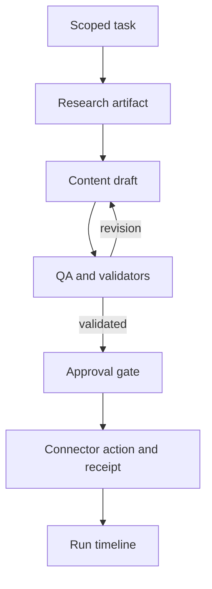

# Dependencies and change-impact register

BZ-115/CW-115 — read-only hosted diagnosis confirms the three existing v2 agents are already approved and bound, but the shared Gemini connectivity test is older than24 hours and the enabled pricing policy expired on October10. Corrected stale admin/customer capability guidance and clarified that onboarding `executionEnabled:false` describes the assessment only. Existing execution/runtime remains implemented; no hosted policy, provider, deployment setting or saved content changed. Founder planning/campaign-save evidence is narrow; MT280–283 and earlier live acceptance remain pending. See [96](96_QUALIFICATION_EXPIRY_AND_EXECUTION_GUIDANCE.md).

Fresh corrective verification:201 admin tests/22 files,565 web tests/96 files,75 ephemeral migrations/38 SQL assertion scripts,both typechecks/lints/production builds,application boundaries,whitespace and1019 local platform Markdown links passed. Web build generated152 static pages including guide96. SQL/auth/provider tests are synthetic; hosted reads were SELECT-only. No live activation/founder/provider acceptance is inferred.

BZ-114/CW-114 — founder-requested second review identified and repaired pending voice-start microphone cleanup; Stop/unmount now releases starting resources immediately and token HTTP is bounded. Fresh533 web tests/92 files, typecheck/lint/build/boundaries/projection verify the correction. First-four documented source stays complete; live/founder acceptance stays pending. No additional source exit identified; no bug-free/public-release claim. Office ON HOLD for founder design; continuation paused. See [95](95_FIRST_FOUR_SECOND_REVIEW.md).

BZ-113/CW-113 — Turn5 final audit closes the documented first-four source implementation, including matching terminal voice-receipt validation and hash-failure-safe closure. All five deliveries are complete after required checks; no sixth coding delivery is planned. Live qualification/activation, founder MT264–279 and earlier unanswered tests remain pending. Group5 office ON HOLD; Group6 out of scope. No hosted write/provider/publication/settings change. See [94](94_FIRST_FOUR_SOURCE_COMPLETION_AND_ACCEPTANCE.md).

BZ-112/CW-112 — fixed Turn4 integrates optional capability isolation, Founder desk media receipts/core links, explicitly consented approved site and selected meeting/proposal voice context, confirmed/retryable close receipts, setup/cancellation guards, cross-site artwork replay protection and mobile/accessibility fixes. MT276–279 and all live/founder acceptance remain pending. No new migration/provider/hosted write/publication/settings change. Turn5 final audit and acceptance package is the sole remaining planned delivery. See [93](93_FIRST_FOUR_INTEGRATION_AND_RECOVERY.md).

BZ-110 dependency record: browser Live voice depends on installed071–073, an enabled current `live-voice` qualification, its current spending profile/credential version, server-only `GEMINI_API_KEY` and `BIZOVEYA_MEDIA_SERVICE_KEY`, microphone permission, WebSocket/audio browser support and actual Gemini quota. Missing any activation dependency disables voice only; typed/pasted proposals, templates, uploads, text execution and meetings remain available. Client usage is not authoritative metered billing. See [91](91_BROWSER_LIVE_VOICE_AND_REVIEWED_HANDOFF.md).

BZ-109/CW-109 — five-delivery Turn 1: additive071–072 implements independent image/live-voice qualification, owner-only durable request admission, immutable provenance, one-attempt server claim/start/receipt boundaries, quota/concurrency limits, shared UTC budget checks and reviewed recovery. Admin Media capabilities and authenticated site media APIs are wired; neither endpoint starts a provider. Unknown usage remains unresolved; token issuance is not completed voice execution. Groups2/3 remain source-complete; Groups1/4 remain open for Turns2/3. Group5 ON HOLD; Group6 out of scope. Routine founder acceptance MT264–267 and earlier unanswered tests remain pending. See [90](90_FIVE_DELIVERY_MEDIA_ADMISSION.md).

BZ-108/CW-108 (2026-10-13 PKT): founder selects Gemini for voice and Nano Banana2 Lite (`gemini-3.1-flash-lite-image`) for optional artwork. Inspected screenshot confirms AI Studio image generation, not API quota/billing qualification. Artwork is optional and must not block text drafts, templates, uploads, assistant execution or meetings; unavailable artwork stops only that capability. Added separate server-side media adapter contracts, one-attempt bounded Gemini image transport and model-constrained120-second Live token provisioning with transcript-only action authority. No endpoint/worker/browser activation or provider request. OpenAI is a future adapter option, not a required credential today. First-four source remains unfinished on durable media admission/accounting and browser voice integration; founder/manual/live tests remain pending. See [89](89_OPTIONAL_ARTWORK_AND_GEMINI_MEDIA_TRANSPORTS.md).

BZ-107/CW-107 hosted setup checkpoint (2026-10-12 PKT): founder explicitly authorized direct Supabase installation, superseding the earlier no-hosted-SQL restriction for reviewed Bizoveya migrations. Verified project `voxfolio` (`lvxrqmgsfarimbhmcbcc`) had schema039 with no tracked migration history. Applied the exact main-source migrations040–070 sequentially through the Supabase migration interface; all31 succeeded and are now tracked. Generation-run, review, visual and visual-history fingerprints were unchanged. All private tables have RLS; private specialist projection denies authenticated execution; `campaign-private-media` is private with a5MiB limit. This completes installation only, not browser/provider/role/concurrency acceptance. Earlier manual behavioral tests remain pending. Media server-key activation and artwork/voice qualification remain outstanding. See [88](88_HOSTED_SUPABASE_INSTALLATION.md).

Additive070 depends on069's immutable specialist lineage and the052 durable task plus generation output/review state. It wraps only the private read model: no write, retry, accounting or provider boundary changes. Any future per-channel runtime must preserve `output_missing` truthfulness or replace it with stronger evidence, and must not infer success from the shared run alone. Group2 source is complete; hosted070 and MT256–259 remain pending. See [87](87_GROUP_TWO_SOURCE_CLOSURE.md).

Additive069 depends on 068 delegation plus the existing 048/051/052 campaign, generation and durable task contracts. It deliberately reuses the single Content stage and its existing qualification, authorization, shared-budget accounting and recovery evidence. Removing or changing delegation, generation snapshot stages, output shape or human review requires a lineage/projection migration; never fan out provider calls implicitly. See [86](86_CHANNEL_SPECIALIST_RUNTIME_LINEAGE.md).

BZ-104/CW-104 adds migration068 and web-only specialist roster/delegation routes. It depends on existing approved Content-agent previews, current bindings/connectivity and spending policies, but makes no provider call. Hosted068 is required before the UI can persist. Existing core roster, campaigns and runtime signatures are unchanged. MT248–251 and all earlier unanswered tests remain pending. See [85](85_PRIVATE_CHANNEL_SPECIALIST_DELEGATION.md).

BZ-103/CW-103 adds067 after066. It depends on an owner-reviewed announcement, its existing reviewed private request distribution, the current pinned invitation batch and every exact recipient acknowledgement. It creates a normal revision-1 knowledge source with `approved=false` through the existing026 mutation boundary and then saves immutable meeting/source lineage. Existing knowledge approval, agent snapshot and generation admission rules remain unchanged. Hosted067 and MT244–247 remain pending. Group3 source is complete; Groups1,2 and4 retain the provider/specialist/voice exits recorded in [84](84_ACKNOWLEDGED_ANNOUNCEMENT_KNOWLEDGE_DRAFTS.md).

BZ-102/CW-102 adds explicit interrupted-turn recovery and immutable snapshot closure through additive066, with admin controls and sanitized Founder desk status. Unknown provider usage requires billing reconciliation; no retry occurs. MT240–243 remain pending. First-four completion is still open; next is the consolidated source-to-plan audit of assistant/specialist, interruption/knowledge, AI visuals and live voice exits. Office visualization stays ON HOLD. See [83](83_MEETING_TERMINAL_RECOVERY_AND_CLOSURE.md).

065 depends on064 outcomes, truthful060–063 lineage, existing private request command and current owner/admin/MFA. No key/provider setting is added. Terminal recovery is next. See [82](82_REVIEWED_MEETING_OUTCOME_REQUEST_HANDOFFS.md).

BZ-100 depends on migrations060–063 and truthful complete request/result/accounting receipts. Migration064 is additive and must be applied after063; no provider credential or new environment variable is required. Reviewed downstream handoff depends on this immutable outcome and remains unimplemented. See [81](81_REVIEWED_MEETING_DELIBERATION_OUTCOMES.md).

063 depends on060 qualified snapshots,061 active consent,062 shared accounting, current owner/platform-admin/MFA, selected provider credentials and the default-off admin flag. It preserves all existing migrations and uses the captured profile/pricing/limits. The next completion model must consume only truthful terminal turn receipts and cannot bypass unresolved accounting. See [80](80_ONE_ATTEMPT_MEETING_TURN_WORKER.md).

## Shared meeting-turn accounting — 2026-10-12 PKT

062 depends on060 immutable snapshots,061 active consent, current owner/admin authorization,054–059 plan/schedule/receipts, current agent/model/connectivity/pricing and032/035 accounting. It wraps current admission functions so meeting charges participate in old daily gates. The next worker must call reserve → record provenance → marker → provider → settle exactly once.

BZ-098/CW-098 adds062 independent meeting-turn reservations, provider-start markers, truthful settlement/reconciliation and shared UTC daily-budget enforcement across connectivity, campaign and meeting ledgers. Exact snapshot/consent/turn/current-dependency guards and ordered idempotent admission are implemented; safe pre-provider cancellation records zero, while unknown/overrun usage blocks fresh work. Admin spending projects sanitized meeting rows. No worker or provider call is connected. MT224–227 and every earlier unanswered test remain pending. Next: one-attempt bounded meeting worker and immutable private request/result receipts. First-four groups remain incomplete, live voice unfinished, office visualization ON HOLD, custom agents out of scope. See [79](79_SHARED_MEETING_TURN_ACCOUNTING.md).

## Expiring founder-admin meeting consent — 2026-10-12 PKT

061 depends on060's immutable qualified snapshot/candidate and054–059 acknowledged ready plan, current owner/admin/MFA and checked model/connectivity/pricing. No hosted SQL was applied. Routine founder tests are deferred; real reservation, shared-budget and provider-start dependencies remain mandatory. Consent expiry/revocation must block fresh billable work without blocking actual started-usage recording.

BZ-097/CW-097 adds061 expiring revocable consent for060 qualified meeting snapshots. The original snapshot founder must remain a workspace owner and MFA-verified platform admin; fresh consent rechecks exact qualification/context/versions. Fixed15-minute expiry, immutable consent/revocation events, exact retries and25-record cap preserve history; revocation remains available after pause/expiry. Separate admin controls and read-only Founder desk projection create no reservation, AI turn or provider call. MT220–223 and all earlier unanswered tests remain pending. Next: independent shared-budget meeting-turn accounting, then bounded execution/results. First-four groups remain incomplete, live voice unfinished, office visualization ON HOLD and custom agents out of scope. See [78](78_MEETING_EXECUTION_CONSENT.md).

060 depends on054–059 actual acknowledged packets, immutable plans and ready schedule; qualification reuses031/032 and checks existing035 accounting. New snapshot storage is independent of campaign generation and does not reuse a campaign reservation as meeting authority. Future meeting accounting must include connectivity, campaign and meeting charges in every shared admission path before enabling execution. Snapshot review/API/Zod/Founder desk and private agency JSON changed together; actual migrated contract fixtures verify their projection. Original migrations/runtimeVersion contracts are unchanged.

## Qualified meeting execution snapshots — 2026-10-11 PKT

BZ-096/CW-096 adds060 owner-reviewed immutable preparation from the ready, acknowledged bounded plan. Current pinned agent/model/credential/connectivity/pricing, approved context, token compatibility and full repeated-turn estimates are checked; fingerprint review rejects intervening changes. Preparation creates no execution authority, reservation, provider call or AI output. MT216–219 and all earlier unanswered tests remain pending. Next: explicit authorization and independent meeting-turn accounting, followed bounded execution/receipts. First-four groups remain incomplete; live voice unfinished, office visualization ON HOLD, custom agents out of scope. See [77](77_QUALIFIED_MEETING_EXECUTION_SNAPSHOTS.md).

## Operator meeting packet delivery — 2026-10-11 PKT

BZ-095/CW-095 supplies the missing receipt-worker prerequisite for bounded deliberation: additive059 owner-scoped admin queue, MFA-protected delivery and deterministic pinned-packet validation through existing054–055 claims/receipts. Reviewed delivery records acknowledged/declined only, with retry/lease/privacy guards; it makes no AI call, spending reservation or participation claim. Hosted setup and MT212–215 remain pending with all earlier unanswered founder tests. Qualified bounded turn admission/execution is next; first-four groups remain incomplete, live voice unfinished, office visualization ON HOLD and custom agents out of scope. See [76](76_OPERATOR_MEETING_PACKET_DELIVERY.md).

## Reviewed deliberation scheduling intent — 2026-10-11 PKT

BZ-094/CW-094 adds owner-reviewed queue, pause, resume and terminal cancel intent with additive058, strict authenticated API, founder-desk controls and immutable event history. Queue/resume require the unchanged enabled pinned team, acknowledged packets and exact meeting/schedule versions. Pause/cancel remain possible after team or parent changes. Exact operation retries return current state without duplicated transitions; final history slots are reserved for safety controls. This is scheduling intent only: no worker admission, AI turn, reservation, spending or result is implemented. Qualified bounded turn execution is next; first-four groups remain incomplete, live voice unfinished, office visualization ON HOLD and custom agents out of scope. MT208–211 and all earlier unanswered founder tests remain pending. See [75](75_DELIBERATION_SCHEDULING_INTENT.md).

## Deliberation identity admission repair — 2026-10-11 PKT

Additive057 explicitly rejects null/non-string/invalid meeting and plan identities before delegating to the owner-only bounded planner. The previous implementation is private with no caller grants. Expanded local SQL regressions cover identity/limit nulls, stale version, paused/changed roster, cancelled meeting, retry, immutable turns, ACLs and zero generation/spending. This is a prerequisite repair, not scheduling or first-four completion. MT204–207 and all earlier founder tests remain pending. Next remains safe deliberation scheduling/admission and pause/resume. See [74](74_DELIBERATION_ADMISSION_REPAIR.md).

Additive056 depends on 055 receipt admission, a decision-recorded deliberation, every exact pinned receipt acknowledged and the same enabled roster still current. It introduces no provider, key or deployment-setting dependency. Later execution must enforce the saved roster, turns, token caps and cost ceiling; planning is not execution authority. Hosted056, actual workers, concurrency and MT204–207 remain pending. See [73](73_BOUNDED_DELIBERATION_PLANS.md).

## Meeting receipt admission repair — 2026-10-11 PKT

Additive 055 rejects omitted worker identity and rechecks owner membership, unchanged meeting and enabled pinned team before new delivery claims. Already claimed packets can still record truthful completion after pause/cancellation; completion grants no new execution authority. Null identity, stale/paused/revoked/cancelled admission, expiry recovery, retry and ACL regressions are covered locally. This repairs prerequisites for the next bounded deliberation-plan slice; first-four groups remain unfinished, office visualization ON HOLD and custom agents out of scope. All founder tests, including MT200–203, remain pending. No new UI field, provider call, hosted SQL, settings, messages, publication or repeated generation. Base main `0aee385a9ffa402809b28124225af7f523b1e6e6`; historical branches/PR2 inspected, no AGENTS or active lease. See [72 receipt repair](72_MEETING_RECEIPT_ADMISSION_HARDENING.md).

Automated evidence: 461 web tests across 78 files, 54 ephemeral local migrations/18 SQL assertion executions, web typecheck/lint, both production builds and application boundaries passed. Documentation projects BZ-090/CW-090/MT200–203 and guide71. Admin source is unchanged; its earlier 145 tests are historical, not claimed as rerun. Hosted/browser/mobile/real worker/concurrency and all founder acceptance remain pending. No active checkpoint lease is retained at handoff.

## Versioned meeting invitations and explicit receipts — 2026-10-11 PKT

Group 3 now prepares owner-reviewed participant packets pinned to the current enabled site-team roster after a meeting decision is distributed. Additive 054 records invited/claimed/acknowledged/declined transitions and immutable receipt history; only the exact pinned service worker can claim and finish a receipt. These states do not claim attendance, understanding, reasoning or task completion, and no provider, spending, publication, message or knowledge update occurs. Bounded deliberation, safe pause/resume and live voice remain unfinished; first-four groups are not complete, office visualization stays ON HOLD and custom agents remain out of scope. Next: bounded deliberation plan preparation from acknowledged packets. See [71 contract and four deferred checks](71_VERSIONED_MEETING_INVITATIONS_AND_RECEIPTS.md). MT200–203 and all earlier unanswered founder tests remain pending. Remote base: `fc8fb5254ef527a50e65aa1bf90b1718683c759d`; historical branches/PR2 inspected, no repository AGENTS or active checkpoint lease.

Automated evidence: 457 web tests across 78 files, 53 ephemeral local migrations/17 SQL assertion executions, web typecheck/lint, both production builds and application boundaries passed. Documentation projects BZ-089/CW-089/MT196–199 and guide70. Admin source is unchanged; its earlier 145 tests are historical, not claimed as rerun. Hosted/browser/mobile/real concurrency and all founder acceptance remain pending. No active checkpoint lease is retained at handoff.

## Reviewed meeting task distribution — 2026-10-11 PKT

Group 3 now atomically links one recorded founder meeting decision to one reviewed private content request through additive 053. The request includes the exact decision and instruction; original agenda, version, channels and actor remain immutable provenance. Owner-only admission, exact retry, stale/role/site/quota guards and refresh projections are implemented. This starts no generation, spending reservation, acknowledgement, attendance, publication or knowledge update. Real participant receipts, bounded deliberation and safe scheduling still need implementation; first-four groups remain unfinished, office visualization ON HOLD and custom agents out of scope. Next: versioned participant invitations and explicit acknowledgements. See [70 contract and four deferred checks](70_REVIEWED_MEETING_TASK_DISTRIBUTION.md). MT196–199 and all earlier unanswered founder tests remain pending. Remote base: `76276e8aa5ac5cb7d8d4a6aab165b2189bae9af8`; historical branches/PR2 inspected, no repository AGENTS or active checkpoint lease.

Automated checkpoint: 451 web tests/78 files, 145 admin tests/14 files and 52 local migrations/16 SQL assertion executions passed. Both typechecks, both lints, both production builds and application boundaries passed. Hosted/browser/real concurrency and MT192–195 remain pending. No provider request or hosted operation.

## Durable assistant execution and recovery — 2026-10-11 PKT

Group 2 now tracks reviewed-request generation through a durable versioned task and immutable events. Admin authorization, actual runtime completion, member status projection and explicit expired-dispatch reconciliation are connected through additive 052. Recovery never calls a provider: no unsettled request can safely resume; an unstarted reservation is guarded-cancelled at zero; provider-start, unknown or overrun evidence blocks retry for manual reconciliation. This is not autonomous scheduling or completion of all first four groups. Group 3 meetings/announcements/task distribution and Group 4 live voice remain unfinished; office visualization stays ON HOLD. Founder acceptance MT192–195 and all earlier unanswered tests remain pending until before public reveal. See [69 contract and four deferred checks](69_DURABLE_ASSISTANT_EXECUTION_AND_RECOVERY.md). No hosted SQL, deployment setting, paid request, publication or accepted generation repeated.

Automated checkpoint:450 web tests/78 files,137 admin tests/14 files,51 local migrations/15 SQL assertion executions, both typechecks, web lint, targeted admin generation lint, boundaries, whitespace and264 affected local Markdown links passed. Both production builds passed; final web/document projection is verified before delivery. Hosted/browser/concurrency and MT188–191 remain pending. No provider request or hosted operation.

## Reviewed request generation preparation — 2026-10-11 PKT

Group2 now links a reviewed saved founder request to exactly one prepared generation snapshot through additive051 and the existing qualified generation admission. Exact request/campaign versions, immutable lineage, retry guards and current run-status projection are implemented. Preparation makes no provider call or spending reservation; execution remains separately authorized in the existing admin runtime. Full assistant dispatch/recovery, actual meetings, optional AI and live voice remain unfinished; office visualization stays ON HOLD. Routine founder acceptance MT188–191 and all earlier unanswered tests remain pending until before public reveal. See [68 contract and four deferred checks](68_REVIEWED_REQUEST_GENERATION_PREPARATION.md). No hosted SQL, deployment settings, paid request, publication or accepted generation repeated. No active checkpoint lease remains at delivery.

## Site team activation and safe checkpoint pause — 2026-10-11 PKT

Group2 now has owner-reviewed site-specific Coordinator/Content/Quality selections, enable/pause controls and immutable history through additive050. Preparation/authorization/new reservation/provider-start boundaries enforce pinned roster versions; started work can still settle. Onboarding respects the selected/paused team. All founder acceptance stays pending until before public reveal; coding continues independently within real dependencies. Assistant dispatch/recovery, meetings, optional AI and live voice remain unfinished; office ON HOLD. See [67 contract and four deferred checks](67_SITE_TEAM_ACTIVATION_AND_SAFE_PAUSE.md). MT184–187 and prior unanswered tests remain pending. No hosted SQL/provider/settings/publication or regeneration; no active checkpoint lease remains at handoff.

## Approved-context onboarding assessment — 2026-10-11 PKT

Group2 adds deterministic approved-fact/preference/role-qualification assessment and owner-reviewed immutable snapshots through additive049. Exact qualification/context fingerprints reject stale reviews; retries,50-review quota and member access are guarded. This makes no analyst AI request, scraping, hiring, execution or spending reservation. Role activation/assistant workers, actual meetings, optional AI and live voice remain unfinished; office ON HOLD. See [66 assessment contract and four deferred checks](66_APPROVED_CONTEXT_ONBOARDING_ASSESSMENTS.md). MT180–183 and all prior unanswered tests stay pending. No hosted SQL/provider/settings/publication or accepted generation repeated; no active checkpoint lease remains at handoff.

## Reviewed founder request handoffs — 2026-10-11 PKT

Group2 now connects owner-reviewed saved requests to one private campaign through additive048, version guards, immutable original brief/lineage and retry-safe quota-protected creation. Opening the linked campaign uses the existing draft runtime separately; this action starts no generation/provider/spending or publication. Analyst/onboarding/hiring, assistant dispatch, meetings, optional AI and live voice remain unfinished; office stays ON HOLD. See [65 contract and four deferred checks](65_REVIEWED_REQUEST_CAMPAIGN_HANDOFFS.md). MT176–179 and all prior unanswered tests remain pending; no hosted migration/settings/credential/provider operation or repeat generation. No active checkpoint lease remains at handoff.

## Retained campaign image drafts — 2026-10-11 PKT

P04.3.4.4e adds migration047 atomic image-draft saves/history, exact saved-base/current-review guards, explicit private sharing to current site members, retained immutable objects and guarded cleanup. The interface reloads images after refresh and previews historical image/text snapshots; existing v1/v2/v3 text/template saves remain intact. Deterministic media persistence is implemented in source; optional AI, assistant workers, agent meetings and live voice remain unfinished. Office stays ON HOLD. See [64 current contract and four deferred checks](64_RETAINED_CAMPAIGN_IMAGE_DRAFTS.md). MT172–175 and all unrelated unanswered tests remain pending. Hosted047 and existing media-key activation are deferred; no assistant hosted SQL/provider/settings/publication or regeneration.

## Reviewed image composition — 2026-10-11 PKT

P04.3.4.4d adds accepted creator-private image selection, hash-verified shared preview/PNG/PDF rendering and owner-reviewed local working-copy exports. Original campaign v1/v2/v3 saves/history remain intact; image attachments are not persisted yet. No new migration/key/provider or hosted change. Founder requests continued first-four work as quickly as possible, with routine manual acceptance deferred. Durable shared image copies, optional AI, actual assistant workers, agent meetings and live voice remain unfinished; office visualization remains ON HOLD. See [63 current contract and four deferred checks](63_REVIEWED_MEDIA_COMPOSITION_AND_EXPORTS.md). MT168–171 and all prior unanswered tests remain pending.

## Private image lifecycle and phase-five gate — 2026-10-11 PKT

Founder explicitly requires full first-four implementation before office visualization. Group5 is ON HOLD; routine founder tests stay deferred and never count as passes. P04.3.4.4c now adds migration046 tracked immutable uploads, authenticated hash-checked byte retrieval, guarded orphan recovery/operator maintenance and creator-private upload/preview/download/review/archive UI. Activation requires missing hosted046 and a server-only media key configured by the operator; the assistant has applied neither. Existing drafts/templates/history remain intact. Group1 renderer/optional AI and groups2–4 workers/meetings/voice remain unfinished. See [62 Current scope, setup and four deferred checks](62_PRIVATE_MEDIA_UPLOADS_AND_PHASE_FIVE_GATE.md). MT164–167 plus all unrelated unanswered tests remain pending.

## Grouped first-four foundation — current source checkpoint

Founder groups media, assistant/delegation, meetings and voice into one delivery effort, defers routine manual acceptance, and reserves visual office/custom agents for later separate deliveries. This checkpoint delivers additive044 media hardening, real bounded image sanitization and additive045 private proposal/meeting-decision storage plus owner-reviewed planning UI. Live uploads/rendering, workers, agent meetings and voice remain unfinished; all four groups are not complete. No hosted SQL/provider/publication/settings change or repeated generation. Read [61 Grouped scope and four deferred checks](61_GROUPED_AGENCY_FOUNDATION_AND_TESTS.md). MT160–163 and all unrelated unanswered tests remain pending; earlier narrow founder passes remain unchanged.

## Private media storage — P04.3.4.4b

Additive043 follows042 and adds no package, key or environment variable. Its service-only admission RPC is unusable until a trusted bounded sanitizer and object lifecycle exist. Existing visuals/templates/migrations are preserved. Hosted043 is not requested for the hidden slice. See [60](60_PRIVATE_MEDIA_STORAGE_AND_SERVER_ACCESS.md).

## Private media foundation — P04.3.4.4a / 2026-10-10 PKT

No new package, key, SQL or environment variable. Storage must enforce creator/site membership, sanitized-byte verification, atomic aggregate quotas, revision locks, retained referenced bytes and authenticated downloads before media activation. Optional AI remains provider-gated. See [59 Private media foundation](59_PRIVATE_MEDIA_CONTRACT_FOUNDATION.md).

## Private-template interface — P04.3.4.3e / 2026-10-10 PKT

Founder authorizes sequential implementation with manual testing deferred. Creator-private inventory/create/revise/version preview/archive controls now appear in accepted campaign Visual drafts; explicit reviewed save applies through the atomic042 boundary. SQL/app quota is aligned to32. No new migration/provider/publishing action. See [58 Interface and four combined tests](58_PRIVATE_TEMPLATE_INTERFACE_AND_TESTS.md). MT156–159, MT152–155 and unrelated tests remain pending; parent acceptance is unchanged. Six later evolution groups remain, plus broader connector/commercial work; activation proceeds only when dependencies permit.

## P04.3.4.3d dependency update

Additive042 requires041 and existing visual/review storage. It adds no package, key or environment setting. Inventory UI is now dependency-permitted but still requires implementation and hosted/founder acceptance. Existing v1/v2 data is preserved. See [57](57_IMMUTABLE_TEMPLATE_VISUAL_PROVENANCE.md).

## P04.3.4.3c dependency update

Server access uses existing session/workspace helpers and additive041. No dependency, environment variable or migration is added. UI remains blocked on copied immutable artifact references with source-review/conflict/legacy preservation. Hosted041 and MT152–155 remain pending. See [56](56_PRIVATE_TEMPLATE_SERVER_ACCESS.md).

## Private-template storage checkpoint — P04.3.4.3b / 2026-10-10 PKT

Additive041 implements creator-private recipe/history storage, checked authenticated inventory/save/archive RPCs, immutable versions and bounded32-record/50-version admission. Local41-migration/five-assertion verification passed; no hosted SQL applied or UI/campaign references activated. See [55 Storage foundation](55_PRIVATE_TEMPLATE_STORAGE.md) for access/deletion policy and optional one-time setup. Next: server integration and copied immutable artifact references before inventory UI. Source/package remains1.26.0; P04.3.4.3 and MT152–155 remain pending/in progress as applicable. No provider/settings/publication or repeat generation.

## Private-template contract checkpoint — P04.3.4.3a / 2026-10-10 PKT

Implemented creator-owned strict design recipes, contiguous immutable versions, expected-version edits/archive and fit-checked version-pinned application helpers. See [54 Contract foundation](54_PRIVATE_TEMPLATE_CONTRACT_FOUNDATION.md). Source/package remains1.26.0; no new inventory UI/API/storage/migration is activated, and this is not P04.3.4.3 completion. Next: separately implement creator-private SQL/storage and immutable artifact references, then reviewed inventory UI. MT152–155 and unrelated pending checks remain open; no new manual test/field/setup now. Founder authorized four-hour continuation attempts without a response; scheduled task created with first run08:07:59PKT, always subject to current dependencies/leases. No hosted SQL/provider/settings/publication.

## External handoff discussion — 2026-10-10 PKT

Founder requests future ChatGPT-created images/documents sent through a Bizoveya plugin into a private inbox, assistant routing, specialist/QA tasks and permission-gated publication; also relevant-channel signals after verified blog/site updates. See [53 External handoff and change signals](53_EXTERNAL_HANDOFF_AND_CHANGE_SIGNALS.md). Intake is proposed as a durable service; broad knowledge is authorization-scoped. Receiving ChatGPT artifacts is separate from subscription inference. Connector transfer capability remains unqualified. Latest documentation needs no feature test; template MT152–155 remain pending. Next P04.3.4.3 can proceed with ownership/version design, but no new runtime/SQL/connector or publication is implemented by this planning checkpoint.

## ChatGPT reasoning research checkpoint — 2026-10-09 UTC

Founder requests a selectable personal Plus-backed reasoning/text option. Official Sign in with ChatGPT supports eligible plan usage, but hosted Bizoveya needs commercial access; no approved client is evidenced. Recorded as planned/blocked, not a working provider. Separate per-user OAuth, account-specific models, streaming transport and subscription accounting are prerequisites; current platform-key adapter is not interchangeable. See [52 ChatGPT plan reasoning](52_CHATGPT_PLAN_REASONING.md) for sources, ordered scope and four simple founder steps. No new field, key, SQL or live test now. Source remains1.26; MT152–155 and unrelated pending tests remain pending; no accepted generation repeated. This is a documentation checkpoint, not phase completion.

## Current template checkpoint — 1.26 / P04.3.4.2

Shared Classic card, Midnight card, Editorial frame and Bold headline designs are implemented for two Pinterest graphics, the six-slide carousel and a new1080×1080 LinkedIn image. Selection changes design only; it does not regenerate text or call a provider. Existing saved v1 scenes/history stay intact. Owner explicitly adds templates/LinkedIn image, reviews and saves a v2 document as a new visual version. Additive040 after039 extends strict validation while retaining original access/source-review/conflict/no-op/version limits. No existing migration/row/history is rewritten.

Founder earlier MT145–147 remain reported passed. New MT152–155 and older MT148–151/unevidenced negatives/commercial blog depth remain pending. [51 Template selection and testing](51_VISUAL_TEMPLATES_AND_LINKEDIN_IMAGE.md) has four steps and every new field sample. No new key/environment/provider/integration/publishing. Personal reusable templates, AI artwork, voice/office/custom agents remain planned in50. Next: founder template/save/refresh/export checks; then separately scope P04.3.4.3 ownership/version contracts, not automatic implementation. This latest block supersedes older current instructions while preserving discussion history.

## 2026-10-08 evolution update — planned direction

P04.3.4.2 depends on current composer/source-review/version compatibility and fit/export evidence. P04.3.4.3 adds creator ownership, private inventory, immutable versions and deletion/export boundaries. Media/AI templates depend on storage/rights/provider eligibility and evaluated safe schema. Assistant precedes durable broadcast; voice and office project the same tasks. Custom-agent activation depends on evaluation/tool permissions. Publishing remains P05/P07-gated. Subscription access is optional; no evidenced commercial client exists. Detailed entry/exit gates and impact matrix in50.

See [50 Evolution record](50_EVOLUTION_TEMPLATES_AND_VISUAL_AGENCY.md) and [ADR-0017](decisions/ADR-0017-templates-and-event-driven-agency.md). Older dated contracts remain historical where superseded.

## Current visual checkpoint — 1.25 / P04.3.4.1 (2026-10-08 PKT)

Founder confirmed the previous saved-draft/refresh/copy/generated-JSON checks and explicitly authorized proceeding. Record these narrow text-pilot checks as founder-reported passes; do not repeat generation. Other unevidenced access/conflict/mobile/unsaved-export tests and the short-blog quality finding remain open. This authorization permits visual implementation without claiming full P04.3.3 acceptance.

P04.3.4.1 adds private editable two-layout Pinterest graphics and a six-slide LinkedIn carousel, shared scene previews/PNG/PDF exports and owner-reviewed saved visual versions. Additive039 follows038; no existing rows/migrations are rewritten. Member reads, owner saves, source-review checks and optimistic conflicts are enforced. Outputs are private; saving/exporting does not publish or call a provider. No new key, env variable, dependency or deployment setting. Hosted039 installation and founder visual tests remain pending.

Next: follow the four steps in [49 Private visual composition](49_PRIVATE_VISUAL_COMPOSITION_AND_TESTING.md): apply039 once if missing, open the already accepted campaign's Visual drafts, review/save/refresh, download two Pinterest PNGs and the six-page PDF. Do not request another text generation. Remote base7acdbd48 inspected; no AGENTS.md or active lease; old PR2/phase branches remain historical. This block supersedes earlier conflicting current-state/next-step guidance while preserving its history.

## Current founder evidence — 2026-10-07 PKT

P04.3.3 is IN PROGRESS. Founder evidence confirms failed Content run `fb12a480-6923-4d3d-a66a-5777fe347f4a` cost reconciled to USD 0 on free-tier attestation (unknown tokens remain unknown), and unstarted run `29293e34-e773-4ffe-88f1-dc9645dd60c6` safely cancelled by the founder after SQL confirmed `provider_started_at` null (failed / preflight_failed, settled, zero tokens).

Live Gemini run `80091597-06eb-4b8e-ae10-6239ae2b2b69`, campaign “Do It With AI Tools — export test-v2”, version2: Coordinator succeeded/settled692 input /668 output, Content1289/716 and Quality1782/321. Founder reports saved Blog/Pinterest/LinkedIn text, fact references, positive QA and no stage errors. Latest review screenshot reportedly confirms Human review saved: reviewv1 accepted at2026-10-07 23:04:49 PKT for private draft use only. Exact reason and evidence limits are recorded in [48 Live draft evidence](48_LIVE_DRAFT_EVIDENCE_AND_REMAINING_GATES.md).

Reload persistence, clipboard/export, stale/negative review, access and other unevidenced tests remain pending. The short blog remains an open commercial-quality finding. No publication or regeneration occurred. Next: complete44/45 acceptance on the existing output, then inspect actual saved blog/brief/limits for quality improvement; no repeat generation is needed. P04.3.4 visuals remain planned until durable text acceptance. No new migration, field, key or deployment setting. No active checkpoint lease was recorded on inspected main `1ca04645c34c13f803a05689d66c26d99d692152`; old PR2/phase branches are historical. This block supersedes earlier next-action/current-state claims below; those retain the evidence available at their original checkpoints.

Verification2026-10-07 PKT:137 admin tests, admin typecheck, targeted runtime lint, both production builds and application boundaries passed. Guide47 rendered in the web document room. No hosted SQL execution, live model request or existing-record recovery performed. No active lease; founder read-only diagnostic is the next action.

## Runtime/SQL contract regression repair — P04.3.3.8 (2026-10-07 PKT)

Founder screenshots21:55–22:00 show snapshot29293e34-e773-4ffe-88f1-dc9645dd60c6 (campaignv2) stuck running, Coordinator reserved, no active dispatch lease, no result after refresh. Previous Content reconciliation forfb12a480 is screenshot-confirmed; this does not settle the new Coordinator reservation.

Code investigation confirmed a regression introduced in P04.3.3.7: runtimeVersion was changed to draft-runtime-v2-ai7.0.127-gemini-compact while migration036 explicitly permits only draft-runtime-v1-ai7.0.127. That rejects bz_record_generation_request after reservation before generateStage. Dispatch then ends its lease but leaves the stage reserved. Prior mock tests did not enforce the SQL literal. This is an implementation defect, not evidence of Gemini billing/credit failure. Hosted exact stop remains pending read-only confirmation.

Repair restores the SQL-compatible runtimeVersion and records transportSchemaVersion=gemini-compact-v1 separately. Request-recording errors now call existing guarded bz_cancel_unstarted_generation_stage before returning failed. SQL refuses cancellation when the provider-start marker exists; ambiguous RPC responses preserve unresolved reservations rather than inventing zero usage. New tests compare the serialized runtime identifier against migration036 itself and cover rejected-record cancellation and refused cleanup. Compact-schema validation/privacy behavior remains intact. No migration or live request; existing stuck record is not automatically rewritten.

Manual next: run the SELECT in tools/operator/inspect-v2-stuck-generation.sql in Supabase SQL Editor (read-only, not a migration). Share request_recorded, runtime_version, stage_status and active_dispatch. Expected for this regression: request_recorded=false, runtime_version=null, stage_status=reserved, active_dispatch=false. If request_recorded=true, preserve accounting and investigate separately. Do not rerun, reconcile or prepare another snapshot before safe recovery of this specific record is established. No key, pricing or account changes. See47.

Verification:134 admin unit tests across14 files passed (12 synthetic provider and15 diagnostic tests); admin typecheck, targeted generation lint, both production builds and app boundaries passed. The new46 guide is included in the built visual document room. Full directory lint scanned generated build artifacts and is not claimed as passing; targeted source lint and build checks passed. No live provider, hosted SQL, browser/manual acceptance, charge reconciliation or production deployment verification performed. No active lease at delivery. Next action: read-only founder checks, then evidence-backed reconciliation of the latest failed Content record before a single controlled new-snapshot test.

## Current diagnostic repair — P04.3.3.7 (2026-10-07 PKT)

Gemini transport now uses a compact JSON schema with canonical validation retained locally (strict keys, lengths, UUIDs and exact approved citations). Provider errors persist only fixed safe labels for response-schema rejection, unmet prerequisite, invalid/blocked key and payment requirement; raw messages, response bodies, URLs and secrets are never stored or exposed. Runtime request provenance is tagged draft-runtime-v2-ai7.0.127-gemini-compact. One attempt,20-second bound and spending reconciliation guards remain unchanged. No migration, provider call or billing activation. Historical failures cannot acquire new details retroactively. This compatibility repair is locally verified only; successful live generation remains pending. See [46 Gemini rejection repair](46_GEMINI_REJECTION_REPAIR.md). This current entry supersedes older next-step guidance without deleting history.

Founder evidence Oct7: old Content cost reconciliation persisted; refreshed connectivity test057e14ae-c5ec-4b9c-933b-c43e4880058f and all three assignments are current. New snapshotfb12a480-6923-4d3d-a66a-5777fe347f4a failed: Coordinator settled689input/553output; Content provider_request_rejected, usage unknown; no completed output/Quality result evidenced. Founder reports no Vercel errors. Caught errors were reduced to a generic stored label, explaining the diagnostic gap. HTTP400 is known; exact cause, schema compatibility, account prerequisite and credit expiry are not established. Latest unknown Content record requires its own evidence-backed reconciliation; the older reconciliation does not cover it. All unevidenced manual checks remain pending.

## Current checkpoint — P04.3.3.6 / private draft review exports (2026-10-07 PKT)

Founder authorizes continued implementation with previous and new manual checks deferred together. Added browser-local JSON downloads for the displayed editable campaign and completed generated output review packet. Unsaved edits are explicitly labelled; generated packets carry snapshot/campaign version, three text channels, citations, QA and review history. Downloads neither save nor call a provider, reconcile charges, accept a draft or publish. No new route, migration, dependency or API key. P04.3.3 remains IN PROGRESS: historical Content failure/unknown usage and successful live generation acceptance remain unresolved. See [45 Combined draft review and manual tests](45_DRAFT_EXPORTS_AND_COMBINED_TESTS.md). This current block supersedes older current-state guidance without deleting history.

## Dispatch/review impact map — 1.24

| Change | Affected dependencies / action |
|---|---|
| Assignment refreshed, model/agent/reference edited | Old snapshot stale; prepare new immutable snapshot, never mutate old input |
| Owner/admin revoked | Queue disappears or dispatch/stage access denied; no cross-tenant privilege |
| Generation flag enabled | Admin POST may call provider after explicit per-run consent; GET/refresh remains read-only |
| Stage saved/settled | Next role can start; combined output visible only when all succeed |
| Missing usage/failed result | Stop; inspect spending; no automatic resend |
| Human review saved | Increment review version/history only; stale tabs conflict; campaign text/provider usage/publishing unchanged |

## Current checkpoint — 1.24 / P04.3.3.5

Explicit founder-owner draft dispatch is implemented on the separate admin deployment at `/admin/generations`, default off. Private campaign outputs now show Blog/Pinterest/LinkedIn text, citations, advisory QA and owner-only versioned human review. Additive037 follows036; no provider request, hosted SQL, publishing or Vercel setting change was made. See [44 Draft pilot and human review](44_DRAFT_PILOT_AND_HUMAN_REVIEW.md). This block supersedes older current-state blocks, which remain historical.

Founder reports the latest Gemini connectivity/three refreshed assignments/campaign readiness checks passed; screenshot independently confirms connectivity and Coordinator, and the prior video confirms Spending reload persistence. This is not whole-phase acceptance or proof of036 installation. New MT138–144 remain pending. P04.3.3 is IN PROGRESS; next is the explicitly activated one-run Gemini pilot and evidence review, not automatic advancement to visuals/publishing.

## Current checkpoint — 1.23 / P04.3.3.4

Server-only bounded draft engine is implemented with exact private request records, one attempt per Coordinator/Content/Quality role, approved-citation validation, durable output/usage settlement and no automatic retries. Additive036 revalidates execution dependencies and repairs connectivity admission to include campaign spending. No Generate route, activation, provider request, customer publication or hosted SQL was performed. See [43 Draft runtime and testing](43_DRAFT_RUNTIME_AND_TESTING.md). This block supersedes older current-state blocks below; those remain historical.

Founder reports034/035 applied; screenshots confirm three agentv2 approvals, Gemini assignments and prepared campaignv3 snapshot/3 stages/count1. Refresh persistence and all other unevidenced manual checks remain pending. Next is authorized dispatch, saved output review and explicit founder pilot activation within the same unfinished P04.3.3 phase.

## Current execution dependency contract — 1.22

Migration035 turns each future generation stage into a durable, ordered, service-only accounting unit. Stage start depends on a prepared034 snapshot, current write-capable membership, successful settled predecessor, unexpired snapshotted pricing, no unresolved test/stage charge and remaining shared profile/day allowance. Stage finish persists structured output/error and usage before terminal state; unknown/overrun remains held for admin reconciliation. Changing rates or bindings affects future034 snapshots, not existing ones. Runtime/provider activation is still absent. See42.

## Current generation dependency contract — 1.21

Campaign generation preparation now fails closed unless the saved campaign version, approved site knowledge, site preferences, exactly one ready coordinator/content/quality agent, current bindings, current connectivity evidence and enabled unexpired reviewed pricing are all available. Migration034 snapshots those exact versions privately. Any later knowledge, agent, model, credential, binding or pricing change affects only future snapshots; a prepared snapshot never silently changes. Execution must revalidate authority and accounting before stage calls. See41.

## Current checkpoint — 1.20 / P04.3.3.1

Private campaign draft storage is implemented at `/workspaces/[workspaceId]/sites/[siteId]/campaigns`, with saved campaign URLs ending in `/[campaignId]`. This checkpoint stores manually authored brief/blog/Pinterest/LinkedIn text; it makes no model request and does not publish. Additive migration033 follows032. P04.3.3 remains in progress: bound-agent orchestration, generation reservations, durable execution/usage and output review are the next work on the SAME `phase/p04-3-3-durable-drafts` branch. See [40 Campaign drafts](40_CAMPAIGN_DRAFTS_AND_TESTING.md).

Founder screenshots on2026-10-03 confirm Gemini connectivity and MT107 settlement:20 input/7 output tokens, pricingv1, held/count amounts$0, run `e5be1ac3-5620-40e0-9498-97febb96fb15`. MT103 saved policy/history is evidenced; refresh persistence is not separately reported. Other unevidenced manual gates stay pending. Pakistan Token Factory onboarding is blocked; Builder application is under review. Nebius support email was drafted for the founder, not sent by the assistant. No main merge, production deployment, hosted SQL or provider call performed.

## Historical contract — 1.19 / P04.3.2

This update supersedes conflicting older “current” blocks below; historical records remain unchanged. Admin-only spending controls are at `/admin/spending` and `/api/admin/spending`. Migration032 follows031; never rerun applied migrations. New connectivity tests require reviewed USD pricing and enabled limits. The ledger reserves a conservative estimate before a provider call, settles reported usage, and holds uncertain/overrun charges until evidence-based reconciliation. Customer draft generation and publishing remain disabled. See [39 Spending controls](39_SPENDING_CONTROLS_AND_TESTING.md).

Founder reported all1.18 MT095–101 passed on2026-10-03; this is founder-reported local acceptance, not independent deployment verification. New MT102–109 remain pending. GitHub write access is restored; delivery uses `phase/p04-3-2-spending-controls`, not main. Main was inspected at1.7; this branch carries cumulative1.19 source. See38 and CONTINUATION for delivery state.

## Historical snapshot — 1.18 / P04.3.1

Reviewed model assignments are implemented at `/admin/bindings` and `/api/admin/bindings` on the separate admin host only. Migration 031 is additive after 030. An assignment pins a checked latest preview-approved agent version, matching-tier checked model profile, enabled credential-reference version and successful matching connectivity-test ID. Evidence must remain less than 24 hours old. Version changes, rotation, revocation or expiry require review; disable retains history. This is assignment configuration, not paid execution, budget enforcement or customer draft generation.

Use [37 Agent model assignments](37_AGENT_MODEL_ASSIGNMENTS.md) for setup and pending MT095–101. Next are P04.3.2 spending controls, P04.3.3 durable text drafts, and P04.3.4 visual composition. Publishing remains deferred. The founder's successful local Gemini test is accepted only for the evidenced case; all other unevidenced manual tests stay pending.

The founder approved one branch/PR per phase and six-hour continuation. GitHub reads succeeded but branch creation returned HTTP403 `Resource not accessible by integration`. No remote branch, commit or PR was created. The schedule was created then paused pending write access. See [38 Delivery and continuation](38_DELIVERY_AND_CONTINUATION.md). Earlier contracts below remain historical where superseded.

## Current contract — package1.17 / P04.0

P04.0 adds an admin-only model connectivity room at /admin/model-tests and /api/admin/model-tests. The saved provider/model uses the AI SDK with fixed OpenAI, Nebius Token Factory and Gemini adapters. It sends a fixed synthetic prompt, requests128 output tokens, waits20 seconds, makes no automatic retry/fallback, and stores redacted results with profile/reference versions, actor, reason and timestamps. No customer knowledge or prompt is sent. This is connectivity evidence, not quality evaluation, agent activation or a spending-budget implementation.

Live tests default off. Explicit operator setup requires the selected private provider key plus an admin-only SUPABASE_SERVICE_ROLE_KEY for server-attested result recording, then BIZOVEYA_ENABLE_MODEL_TESTS=true and per-request pricing/charge acknowledgement. No secret-entry form exists. Named current admin+AAL2 is required; client roles cannot mark results passed. Additive030 enforces one running test and five attempts per UTC day platform-wide, durable request IDs, expiry/unknown states and version-sensitive evidence. Failures/unknown attempts still consume the attempt allowance and may be billed. Existing dailyBudgetCents remains planning metadata; monetary enforcement precedes customer runtime.

Read36_MODEL_CONNECTIVITY_AND_TESTING.md for exact setup, supported evidence and MT087–094. All1.16 tests and earlier unevidenced founder gates stay pending; the founder is currently testing and has supplied no new pass results. Preserve001–029 and historical files. One cumulative ZIP/repository and the same two Vercel roots. No hosted SQL/deploy/provider request was performed by the assistant. Next implementation dependency: reviewed exact-model evidence, agent/profile binding, enforced monetary limits and durable draft runs, then visual output composition. The35 draft-only pilot and34 Studio/removal scope remain in force; publishing remains deferred.

Earlier release contracts below are historical and superseded where they conflict with this current contract.

## Historical contract — package1.16 / P02.5

The initial new-website audience is freelancers, consultants and small digital-service agencies. Existing sites remain niche-independent registrations. P02.5 repairs Studio and adds owner-only permanent site-record removal: collapsible workspace navigation (collapsed on Studio entry), bounded independently scrolling panels, whole-card section selection, canvas-local selected-section scrolling, homepage Hero/FAQ placement rules, explicit legacy order repair, 120-character headline/320-character hero introduction with counters, bounded responsive photo frames with fitting/focus, optional shared HTTPS logo, sample-fill with confirmation/Undo, section navigation/mobile menu and focused Professional Practice/Creative Business styling. Shared rendering serves preview and existing snapshot publication. No silent legacy row rewrite or automatic sample save/publish.

Additive029_business_studio_and_site_removal.sql preserves001–028. It accepts optional logo/photo metadata, keeps legacy read compatibility, enforces editorial rules on new saves/publication, and exposes owner-only version/name-confirmed bz_delete_site. Site removal cascades this site's business draft/public snapshots/history, knowledge/revisions/events and agent preferences, retaining a content-free owner-readable removal event. External hosting and original portfolio projects remain intact. This is permanent removal, not archiving/restoration. Old duplicate records are removed individually by their owner; no automatic merge.

The first agent pilot is now drafts only for doitwithai.tools: blog, Pinterest copy+rendered graphic, LinkedIn post and rendered carousel/PDF. This phase documents the pilot; live model execution and visual generation are not implemented here. Five proposed roles (coordinator, writer, QA, Pinterest, LinkedIn) share a future visual composer. Social OAuth and CMS writes are not prerequisites for draft generation. Model provider qualification/binding/enforced budget and stored runs remain prerequisites. Multipage/custom collections/listing-entry/navigation/media uploads/gallery/video blocks remain planned; current business sites still have one homepage with section navigation.34 contains current repairs/manual cases;35 contains pilot briefs and owner-reviewable starter knowledge.30 remains cumulative.

Founder reported all newly created Supabase files applied in the review; record this as founder-reported through028 setup, not independently verified database state. Studio/onboarding/deletion findings are open until owner retests1.16. Earlier unspecified acceptance/security gates remain pending. This is a living plan; subsequent founder instructions can revise it, with affected documents, code, migration, dependency and activity records updated together. One cumulative ZIP/repository, two existing Vercel app roots. No remote database/deployment/provider action performed.

Earlier sections remain historical; this current contract supersedes conflicts.

## Historical contract — package1.15 / P04.2.1

Provider/ref registry change affects contracts + private SQL + server fixed env map + forms/tests/docs. Profile save appends immutable version and resets current checked status. Reference enabled/rotation version change invalidates dependent checks automatically; raw env change requires explicit record-rotation. Future agent binding must pin checked profile/ref versions and revalidate at task start. Current P04.1 previews do not depend on new profiles and remain unchanged.

P04.2.1 adds model-profile preparation and fixed credential references on the separate admin host. /admin/models saves immutable candidate versions and checks syntax/reference eligibility; /admin/credentials enables/disables or records rotation of the three fixed platform references. All reads/writes require current named admin+AAL2 in server and SQL. No key value is stored in the database or accepted by these forms/APIs. Keys are optional server-only BIZOVEYA_NEBIUS_API_KEY, BIZOVEYA_OPENAI_API_KEY or BIZOVEYA_GEMINI_API_KEY variables managed privately in deployment settings. Presence checks return only a boolean for the current admin deployment, providerValidated:false and runtimeEnabled:false. They do not authenticate providers or prove model availability.

No live calls, SDK runtime, secret-entry dashboard, actual provider revocation, model evaluation, profile-to-agent binding, fallback execution or enforced spend budget is implemented. Profiles remain candidates; tiers/token/budget values are future runtime metadata. Disabling a reference or recording rotation increments its version and invalidates prior dependent profile checks. Changing an environment variable alone is not detected as rotation; operator must redeploy and record it. Checks record current reference eligibility, not credential health. Admin scope remains separate from customer tenancy.

Additive028_model_profiles.sql preserves001–027 and historical data.32 profile definitions/100 versions each; latest30 versions and100 events displayed, older records retained. Same cumulative source repository and two Vercel projects. Optional provider variables belong on admin server for presence checks; a future runtime deployment must be configured independently. No key is needed to test missing-key states; no provider call/spend performed. See33 for exact workflow/new MT068–074;30 accumulates all pending steps. No founder test result was supplied by the continuation request, so all unevidenced acceptance remains pending.50 previous current MD plus33 and ADR-0012 makes52 current sources after rebuild.

Earlier sections retain history; this current contract supersedes conflicts.

## Historical contract — package1.14 / P04.1

Changing role/capability/output schema requires shared contract + SQL validation/catalog + both app consumers + tests + docs. New role requires code/migration, not only dashboard text. Changing default rules appends version, then check/review/preview pointer update; existing preview remains pinned. Knowledge approve/revoke/correct → next context preview changes; preference save → version conflict invalidates stale preview requests. New template does not mutate rules automatically; template registry remains separate until explicit future tool-context integration. No live run cache exists.

P04.1 implements agent configuration and readiness only. The separate admin host has /admin/agents: versioned drafts, schema/capability checks, human approval for context preview, review events, revocation and rollback to a previously checked version. Three migration-authored starter drafts (coordinator, content, quality) begin unchecked and unapproved. A saved edit creates a new immutable version; previous preview approval remains pinned until explicitly changed or revoked. Editing does not activate an agent. No live model execution, credential store, SDK runtime, external tools, provider calls or API spend is added.

Customer route /workspaces/[workspaceId]/sites/[siteId]/agents supports versioned site preferences and a current approved-knowledge context preview. Owner/editor write preferences; viewer reads. The backend checks membership/site binding, exact agent preview version and preferences version. Facts carry source/fact/revision citations. Platform instructions remain admin-only; platform admin alone cannot read customer knowledge. Client guidance and uploaded facts cannot grant permission. Preview is a snapshot, not a model answer; future execution must revalidate all approvals and versions.

Additive027_agent_configuration.sql retains001–026 and old project data. One shared @bizoveya/agent-contract workspace package defines typed role/capability/request contracts for both apps. The lockfile adds workspace links; third-party dependency versions stay unchanged. No new environment variable, model key, repository or deployment project. Upload packages/ along with both apps and rebuild both Vercel projects. See32 for exact setup, limits, routes and manual cases;30 combines all deferred actions. Founder has started testing but reported no results yet, so every unevidenced manual gate remains pending.

Earlier sections retain history and are superseded where they conflict with this current contract.

## Historical contract — package1.13 / P03.1

Knowledge dependency edges: source edit -> new source revision -> approval reset -> excludes current retrieval; owner approve -> current approved facts/citations; revoke/delete -> retrieval exclusion; delete -> all source revisions erased but content-free event retained. Future agent snapshots must pin sourceId/version/factId and re-check approval/membership before actions. No outbox/vector purge/controller is claimed implemented.

P03.1 adds a private knowledge room to every registered site mode. Sources may be pasted or imported as UTF-8 .txt/.md, reviewed as editable fact candidates, saved with revisions, and explicitly approved by the workspace owner. Changes remove approval; retrieval is authenticated, current, approved-only and site-scoped. Editors draft; viewers read; only owners approve/revoke/delete. No model call, API key, embeddings, PDF/OCR, public chatbot or automatic website update is added. Additive026 supplies private sources/revisions/content-free activity events and membership-gated RPCs. See31 for behavior and30 for all pending manual/setup steps. All previously deferred founder tests remain pending.

Earlier sections retain historical delivery context and are superseded where they conflict with this current contract.

## Historical contract — package1.12 / P02.4

New template ID affects catalog, Zod enum,025 SQL validator, page metadata/link/query selection, creation radio cards, Studio preset list, SVG/styles, preview/public parser, tests/manuals/docs. Future agents must consume catalog IDs/version when implemented; no running agent exists to update now. Schema changes require forward migrations, public projection compatibility and legacy regression. P02.4 adds Wellness Studio, Education Academy and Product Launch: six business families total. One catalog drives schema, template pages, creation and Studio; the shared section renderer also serves published snapshots. Additive025 expands accepted IDs without rewriting old data. Eight section types/nineteen layouts remain unchanged. No booking, checkout, LMS, enquiry inbox, custom domains or agents are added. See29 for template scope and30 for the combined pending setup/tests. Manual acceptance remains pending.

Older delivery sections retain history; this current contract supersedes conflicting capability/setup statements.

## Historical contract — package1.11 / P02.3.1

| Capability/change | Affected consumers | Required evidence |
|---|---|---|
| Business schema/section/layout | Draft validator,024 projection, public parser, preview, metadata, saved snapshots | Old snapshot compatibility + hidden/unused payload negatives |
| Save version | Publish expected draft version + Studio status | Private save leaves live snapshot intact |
| Publication action/version | API/store/RPC, current state/history, UI, visitor route | Conflict, idempotent unchanged call, rollback, unpublish404 |
| Membership/site mode | Draft/publication member reads and mutation | Viewer/outsider denied; external site cannot publish |
| Contact fields | Readiness, SQL gate, renderer email/call, manual tests | Email-only/phone-only actionable public page |
| Public route/origin | Visitor URL, metadata canonical, links, domain policy | Anonymous fresh request and correct canonical origin |

Native business publishing now uses an explicit saved snapshot and `/sites/[siteId]` visitor route. Saves remain private; publishing/republishing/unpublishing use membership checks, draft/publication version conflicts, and additive024. Hidden sections are removed from anonymous payloads; full snapshot history stays member-only. Owner/editor can publish; viewer cannot. Custom domains, enquiry-form delivery and AI agents remain planned. See28 for setup/manual acceptance and ADR-0008 for architecture. Admin app and inherited portfolio remain unchanged.

Earlier release sections retain history and are superseded where they conflict with this current contract.

## Historical contract — package1.10 / P02.2.Fix-1

Impact chain for this fix: template catalog → creation UI/query intent → register schema → workspace API/store → atomic SQL initial draft → Studio preview/version/save → site cards → manual/QA/evidence/visual docs. Identity key contracts affect create, edit, rename, conflict messages, duplicate annotations, indexes and operator report. Changing a template style reuses BusinessPreview/section contracts; future voice/agent consumers remain planned and must read the same catalog rather than duplicated prompt facts. Main header auth changes must not alter admin access.

Earlier release sections retain history; this current contract supersedes conflicting behavior descriptions.

## Historical contract — package1.9 / P02.2

| Change | Affected consumers | Required checks |
|---|---|---|
| Add section type/layout | domain catalogue/schema, SQL validator via NEW migration, preview, inspector, preset tests, manual/spec | Supported/unsupported payloads, role checks, old drafts, all variants |
| Add preset using existing types | shared recipe/catalogue, gallery, demo route/sitemap, screenshots, docs; future agent discovery | Content/ID preservation, route rendering, section count limit |
| Change shared fact | all bound hero/about/services/contact instances; future knowledge sync | One edit updates every bound consumer; no independent stale copy |
| Retire preset | catalogue selection + retained old renderer/schema; data migration decision | Existing saved sites preserved, no forced silent switch |
| Change section identity | undo state, imported JSON, renderer anchors, future agent commands | No collisions/broken contact anchors; actual upgrade plan |
| Change image handling | URL schema/SQL, renderer, privacy guidance, asset policy | Unsafe references rejected; failed/no-photo layouts work |

Implemented catalogue is static typed metadata, not a dependency-controller service or autonomous agent refresh. Adding capability requires tests and documentation in the same delivery.

Earlier dated sections below retain history; this current contract supersedes conflicting instructions.

## Historical contract — package1.8 / P02.1

| Change node | Affected nodes | Required verification |
|---|---|---|
| Business schema/template ID | catalog, workbench, preview, SQL021 validator/RPC, save schema, manual | Valid/invalid payloads, migration compatibility |
| New template metadata | shared catalog, gallery, onboarding, future agent knowledge/profile version | Route/card consistency; no agent update claimed before agents exist |
| Root/homepage entry | old demo links, login copy, manifest, sitemap, manual, presentation | `/portfolio` regression; new journeys |
| Draft access/role change | editor readonly state, API, RLS/RPC, viewer/revocation tests | Cross-tenant/role denial and no stale overwrite |
| Draft save behavior | workbench status/download/dirty warning, API/store, docs | Save/reload/version-conflict |

Business API and preview share the same domain schema. Avoid separate hardcoded template descriptions in future agents: bind catalog ID/version. Current catalog metadata lives in apps/web/src/domain/business.ts; layout remains code. Backward schema changes require a forward migration and ADR, not rewriting021 after application.

Earlier sections below retain planning/delivery history; conflicting capability or path descriptions are superseded by this current contract and document25.

**Package 1.3 / P01.3 planning slice.** This is a living design register, not an implemented dependency controller. Update it with every feature, removal, fix, schema or configuration change. Latest owner instructions can revise the design; record the reason and affected items rather than silently replacing history. Route IDs and implementation states are canonical in [20_ROUTE_AND_TRANSITION_REGISTER.md](20_ROUTE_AND_TRANSITION_REGISTER.md).

## Ownership and stable identifiers

Use stable IDs independent of display name or URL. `R-` identifies an observed route, `W-` a planned workspace page, `A-` an admin page, `API-` a planned API contract, `C-` a capability, `E-` a domain event and `ACT-` a meaningful user action. IDs are never recycled after removal. Each implemented item must name its owner module, requirements, callers, authorization, input/output schema, storage, downstream consumers, failure/recovery behavior and tests. A button that only opens a menu belongs to its screen/component; a publish, upload, approval, activation or cancellation button needs an action contract. This keeps traceability useful without creating a separate ledger row for every decorative icon.

| Capability | Owner boundary | Depends on | Consumers / change impact | Planned proof |
|---|---|---|---|---|
| C-IDENTITY | Auth and membership service | Verified session, workspace membership, platform roles | Every protected page/API, RLS, agent tool scope, support access | Cross-tenant, direct-API, revoked-role and unauthenticated negatives |
| C-SITES | Site registry | C-IDENTITY, ownership declaration, site mode | Workspace navigation, knowledge, tasks, integrations, template choice | Two sites in one workspace; another workspace denied; URL-only registration causes no external write |
| C-TEMPLATES | Versioned template catalog and supported renderer | Approved schema/components, asset references | Builder, onboarding voice, preview, QA, admin template UI, presentation | New template discoverable through catalog; old portfolio renders; unsupported component rejected |
| C-COMMANDS | Existing validated editing/revision pipeline | Project permissions, document schema, supported commands | Manual editor, voice tools, preview, undo/revisions, publish | Same command validated across manual/voice callers; legacy fixture preserved |
| C-KNOWLEDGE | Site-scoped facts and retrieval | C-IDENTITY, C-SITES, extraction/provenance | Research, content, QA, website assistant, meetings | Scope isolation, fact correction, provenance and deletion propagation |
| C-CONFIG | Agent/config/model-profile versions | Platform roles, allowed tool schemas, evaluations | Runtime, admin, QA, cost policy | Draft/test/activate/rollback; running tasks retain pinned snapshot |
| C-CREDENTIALS | Server secret references and connector grants | Auth, secret store, rotation/revoke policy | Model gateway and individual connector adapters | No stored secret returned; revoked grant denies new operations |
| C-RUNTIME | Task coordinator and bounded workers | Config snapshot, model adapter, identity, knowledge, budget | Specialists, task timeline, meetings, approvals, metrics | Malformed output rejected; retry bounded; no duplicate side effect |
| C-APPROVALS | Action authorization and receipts | Actor role, artifact version, connector capability | CMS write, social action, code PR, publishing | Changed artifact invalidates approval; timeout reconciled before retry |
| C-CONNECTORS | Provider-specific adapters | Authorized grant, capability matrix, revision checks | Site inspection, CMS, Pinterest, GitHub/Vercel | Scope denial, conflict, readback and idempotency evidence |
| C-MEETINGS | Durable meeting/interrupt state | C-RUNTIME, scoped participants, task graph | Founder interventions, specialist handoffs, action items | Stop/pause/amend survive reload; in-flight action reconciled |
| C-OBSERVABILITY | Redacted audit/run/usage records | Event schemas, receipt IDs, cost/time definitions | Task UI, admin metrics, QA, support, release evidence | Defined metric window; secrets/private payloads excluded |
| C-DOCS | Canonical Markdown and visual projection | Current docs loader, phase/log/version formats | Public document dashboard and cross-chat handoff | Every current Markdown generates a linked page; history excluded |

## Template and voice-agent example

**Do not duplicate the complete template catalog in each agent prompt.** Planned catalog entries have stable template ID, version, category, supported document type, sections, editable fields, supported command IDs, preview/asset references and lifecycle state. The onboarding/voice adapter reads the authorized catalog through a bounded tool. Model reasoning proposes a supported command; the existing command validator decides whether it can execute. A new layout or command still requires code and tests; an admin form cannot create executable capabilities from prose.

| Change | Required downstream work | What does not automatically change |
|---|---|---|
| New template using existing sections/commands | Catalog/version, renderer mapping, picker/preview, knowledge/tool response, QA fixtures, manual and screenshots | Agent default prompt need not be rewritten if it discovers the catalog dynamically |
| New section or edit command | Document schema/version compatibility, renderer, command validator, voice tool contract, manual editor, QA, migration if needed | Stored old documents are not silently converted without compatibility plan |
| Retire a template | Hide from new selections; preserve renderer/version for existing sites; explain migration option | Published sites are not broken or auto-switched |
| Update template metadata | Invalidate affected catalog reads/cache; refresh supported UI and docs | Running tasks keep their recorded template/config version |

## Agent communication and task dependencies

Coordinator owns the task graph. Specialists communicate through typed artifacts and persisted task/run references, not unrestricted conversations or shared global memory. Each handoff carries workspace/site IDs, parent task, artifact/version, provenance, allowed next capability, approval requirement and config snapshot. A dependency can be required, optional or gated; a consumer can start only when its required inputs are valid. Quality review can request a bounded revision, but never recursively invoke itself forever.

An agent addition must specify role, input/output schema, permitted tools, budgets, upstream artifacts, downstream consumer, timeout/retry policy and evaluation fixtures. A client instruction cannot expand platform permissions. Changing a model profile requires tool/structured-output compatibility checks; replacing the reasoning provider does not replace account authorization, durable execution or integration code.

## Contract and event register — proposed

Events are emitted after a committed state transition. Use event ID, schema version, UTC occurred-at time, workspace/site scope, actor, entity/version, correlation/run ID and redacted payload. Persist source change and outbox atomically if asynchronous processing is introduced. Consumers deduplicate by event ID, tolerate supported schema versions and reconcile failed delivery. Do not add a queue solely for synchronous catalog reads.

| Event | Producer | Consumers | Invalidation / recovery |
|---|---|---|---|
| E-TEMPLATE-CHANGED | Template administration | Builder/voice catalog readers, preview cache, evaluations | Refresh new reads; preserve referenced old versions |
| E-KNOWLEDGE-CHANGED | Approved fact revision | Retrieval index, queued task validation, site assistant | Scope/version checks; delete affected derived records when required |
| E-CONFIG-ACTIVATED | Tested config activation | New-run resolver, audit | Existing runs stay pinned; rollback selects prior approved version |
| E-GRANT-REVOKED | Connector/credential service | Runtime and adapter authorization | Block new use immediately; reconcile in-flight receipts |
| E-ARTIFACT-CHANGED | Draft/task service | Approval gate, QA | Stale approval invalidated; validate new artifact version |
| E-TASK-INTERRUPTED | Meeting/task controls | Coordinator, worker, timeline | Cancellation token/status checked before side effect; resume only from reconciled state |
| E-ACTION-RECONCILED | Connector receipt service | Task timeline, audit, usage | Record actual remote state; retry only when safe |

## Change-impact procedure — required for every delivery

1. Identify changed requirement, capability, action and route IDs; inspect actual imports/callers, schema, grants and data ownership. This register is a starting map, not proof that all runtime dependencies are known.
2. Follow direct and transitive dependencies. Classify code, configuration, persisted data, external connector, customer UX and documentation impacts; record unaffected checks with a reason where useful.
3. Define compatibility and rollout: schema version, existing-record handling, contract change, cache/index refresh, in-flight runs, permissions, migration and rollback. Never rewrite applied SQL migrations or delivered ZIP history.
4. Implement the bounded slice; run relevant producer/consumer contract tests, affected regression and authorization tests. Live connector effects require actual scoped authorization and redacted receipts.
5. Update every affected canonical document plus manual/presentation for visible changes; rebuild the visual room. Append activity, completed-only result, package filename and verification evidence. Review orphaned navigation, retired actions and stale instructions.

| Impact record field | Required evidence |
|---|---|
| Change ID / actor / timestamp | Activity event, package or source commit; exact model identity only when known |
| Changed entities / requirements | Stable IDs, paths and before/after contract/config versions |
| Direct / transitive consumers | Modules, routes, actions, storage, integrations and documentation |
| Safety / compatibility | Tenant grants, data migration, approval validity, in-flight run policy |
| Verification / release | Commands/results, relevant manual actions, rollback and unresolved gaps |

Initially maintain this register in Markdown and enforce it in handoffs/review. Later derive route/catalog metadata and validate missing references in CI when the real implementation warrants it. A centralized AI 'dependency controller' is **not** required, and cannot replace explicit module contracts or tests.

## Package 1.4 — first practical workspace implementation

## Change impact — package 1.4 workspace source implementation

| Changed entity / action | Producer and consumers | Compatibility / permission impact | Verification / remaining gate |
|---|---|---|---|
| C-IDENTITY / C-SITES; ACT-WORKSPACE-CREATE | Cookie session → workspace RPC → selector/overview | Atomic creator membership; no platform role; no direct self-grant | API/service tests; staging SQL pending |
| ACT-SITE-REGISTER; W-003 | Strict form/schema → scoped API/RPC → site list/detail/counters | URL registration does not fetch/write; native link requires original owner; business mode is planning | Domain/service/UI tests; two-site live walkthrough pending |
| ACT-SITE-UPDATE; W-004 / API-003 | Metadata form → RPC → record/list/overview | Expected-version conflict; URL reattestation; mode/link immutable; registry status only | Conflict/schema tests; live concurrent sessions pending |
| ACT-WORKSPACE-RENAME; W-014 / API-020 | Settings → owner-only RPC → navigation/selector | Name/version only; role/ownership unchanged | Owner/editor service tests; live preview pending |
| Legacy project link/deletion | Native registry FK and Studio/publication routes | No project RLS or command change; ON DELETE SET NULL preserves deletion | Existing regression tests; staging mapping/delete script pending |
| Navigation / metadata | `/projects`, `/start`, root applicationName, robots | Adds workspace entry; keeps all public/share/editor URLs; private routes noindex | Build/static checks; browser and legacy live smoke pending |
| C-DOCS / package metadata | Canonical sources → existing document renderer/dashboard | 30 Markdown documents, no history projection; package 1.4, stable work IDs | Full projection/link/source/archive checks |

No domain-event bus, template-catalog runtime, agent handoff executor or dependency-controller service is installed. Actor/time/package evidence is in ACTIVITY_LOG; exact changed paths/hashes and checks are in the delivery JSON. Future consumers must implement their own contracts rather than interpret this first registry as a grant to act on external accounts.

## Package 1.5 — admin change-impact record

| Action/capability | Producer / dependencies | Consumers / effects | Failure and verification |
|---|---|---|---|
| ACT-ADMIN-GRANT / C-IDENTITY | Trusted operator procedure; existing Auth user; migration 019 | Own eligibility RPC, protected page/API guards, grant counter, role-change audit | Invalid subject/reason rejected; no client EXECUTE; repeated grant is no-op |
| ACT-ADMIN-MFA / C-IDENTITY | Approved account; Supabase TOTP and SSR cookies | AAL2 permission for overview/audit RPCs and pages | Wrong code stays denied; reload/session proof pending; no stored setup secrets |
| ACT-ADMIN-REVOKE / C-IDENTITY | Operator deletion of grant | Next global page/API/RPC denied; audit records revocation | Cannot retract data already seen; no cached positive grants; staging revocation assertion |
| C-OBSERVABILITY admin reads | Current DB grant+AAL2, workspace tables and audit | Overview counts and latest-100 UTC timeline | Strict output shape; no private tenant content; no fictitious metrics |
| C-DOCS | All affected canonical sources plus runbook 21 | Existing public room, phase/status/manual/handoff | Rebuild projection and verify links/route IDs; operational audit stays private |

Owner modules: `src/features/admin/{access,api,page-data,store,mfa,frame,views}` and migration 019. New route IDs R-056–R-060; A-001/A-012 implemented, A-014 security added; API-019 implemented, API-021 summary added. No queue/domain-event bus is needed for immediate DB grant reads. Existing workspace/portfolio mutation and voice/template paths remain byte-preserved. Future staff roles or admin writes must update the DB guard, app gate, audit/schema, all consumers, tests and this impact record together.

## Package1.6 — dependency repair and verification

| Change / work item | Producer and dependencies | Affected consumers | Proof / remaining boundary |
|---|---|---|---|
| P01.4.Fix-1 / ACT-ADMIN-REVOKE | Auth account lifecycle; private operator function; migration020 | Grant eligibility, revocation, audit, recovery runbook | Failing019/passing020 SQL regression; real Auth lifecycle still needs staging |
| P01.1.Fix-1 / C-DOCS | Recorded ZIP table rows and current document inventory | Dashboard hero/metrics/sidebar, detail metadata, phase summary wording | Parser/component/browser regression; future ZIP record updates flow through on rebuild |
| P01 local verification | Actual migration files plus explicit local fixtures; browser on loopback | Test evidence, phase gates, handoff, source-preservation claims | No provider or hosted-environment assumptions; no new runtime dependency |

Route IDs R-030/R-031 are changed in source; R-056–R-060 and workspace routes are exercised but not structurally changed. The dependency register remains documentary rather than an autonomous controller. Update tests if the package-table contract changes. Optional test tooling is separate from the production app dependency graph.

## Package1.7 — separate admin application (current contract)

This section supersedes earlier same-host admin/source-path instructions for the current package, while preserving those earlier delivery records. Under ADR-0004, public code is apps/web/src; admin code is apps/admin/src. Source folders are not URL prefixes. The main host has no /admin or /api/admin pages/handlers, no admin button or redirect. Admin-only paths belong to the separate host; / redirects to its /login, with approved-role/MFA checks for protected pages/APIs. Admin has no customer/docs/marketing routes. All canonical Markdown remains at root docs/platform and is visualized only by the main app. Both deploy independently from one repository/ZIP; shared Supabase/migrations remain centrally managed. See23 for founder-reported testing,24 for explicit install/deploy/environment/manual instructions, and ADR-0004 for the decision. No new migration or live domain configuration is delivered. Real admin Auth/MFA, tenant isolation and production acceptance remain pending. Current source paths elsewhere in prior historical sections must be interpreted through this ownership map.

## P02.5 impact map

business.ts optional metadata -> workbench -> shared preview -> draft API ->029 validator -> saved/public snapshots. Editing policy -> add/move/duplicate/hide/explicit arrange -> saveBusinessSchema ->029 save and publication gates. Existing rows/read schema stay permissive, new writes strict. WorkspaceFrame collapse affects editor width only. Auth-aware get-started -> verified server user -> workspace lookup -> retained journey/template.

DeleteSite -> DELETE site API -> getSite/owner ->029 locked DB deletion -> existing child FKs -> public read unavailable -> list refresh -> removal event. Original portfolio is referenced parent, not child. Future media/jobs/connectors must extend removal rules before introduction. Collection/page model will affect slugs/menu refs/list/detail renderers, knowledge refresh and future website agent tools; not implemented now. Social roles require shared agent-contract + SQL/registry/UI/tool enforcement before eligibility.

## Runtime change-impact map — 1.23

| Change | Effect before the next provider stage | Required action |
|---|---|---|
| Campaign or preferences version | Existing snapshot becomes stale | Save and prepare a fresh snapshot |
| Knowledge edit/revocation | Exact approved versions are no longer valid | Review/approve facts and prepare fresh snapshot |
| Agent approval/model/credential/binding change or expired test | Stage claim is rejected | Review configuration, connectivity and binding; prepare fresh snapshot |
| Pricing policy change/expiry | Captured policy can no longer authorize execution | Review current prices and prepare fresh snapshot |
| Prior uncertain/overrun spending | Both connectivity and generation admission block | Evidence-based reconciliation; never blindly retry |
| Settled successful stage | Resume skips that role | Continue only unclaimed next role |
| Provider dispatch recorded without result | Role remains held; no second attempt | Operator reviews provider evidence |

## Draft diagnostic repair dependency

Migration038 adds stage diagnostics to the037 admin queue. Admin schema defaults missing stages to an empty array so a code deployment before038 retains compatibility. Diagnostic rendering is read-only; it does not unblock reconciliation, change snapshots or authorize retry. Markdown changes project automatically through the document-room source reader.
Turn3 generated artwork depends on independent current image qualification, server-only Gemini and media-service credentials, durable071–072 admission/accounting and additives074–075 generated-attempt storage/replay. It reuses the private bucket/review/composition contracts from043–047. A missing/paused/failed image capability disables only AI artwork; uploads, templates, text drafts, assistant execution and meetings must remain usable. Real API/quota/pricing evidence and MT272–275 remain pending. See [92](92_PRIVATE_GENERATED_ARTWORK_EXECUTION.md).
