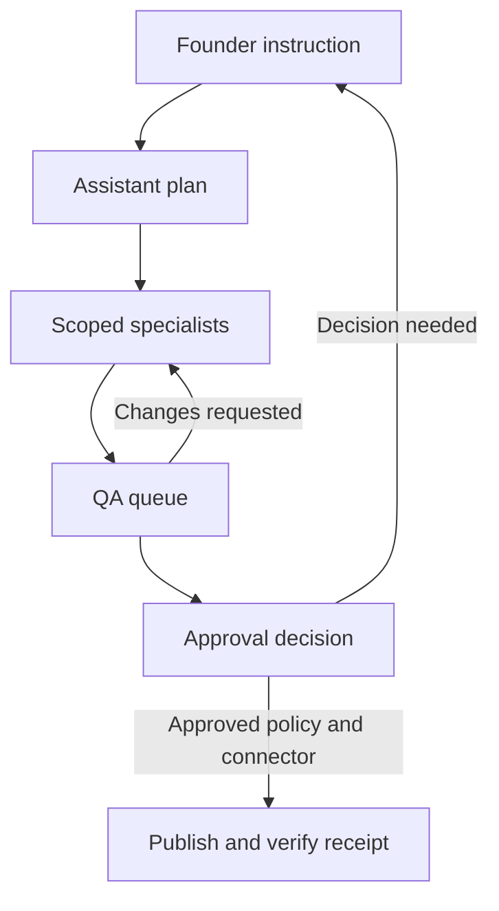

# Evolution record: templates, voice and the visual digital agency

BZ-109/CW-109 — five-delivery Turn 1: additive071–072 implements independent image/live-voice qualification, owner-only durable request admission, immutable provenance, one-attempt server claim/start/receipt boundaries, quota/concurrency limits, shared UTC budget checks and reviewed recovery. Admin Media capabilities and authenticated site media APIs are wired; neither endpoint starts a provider. Unknown usage remains unresolved; token issuance is not completed voice execution. Groups2/3 remain source-complete; Groups1/4 remain open for Turns2/3. Group5 ON HOLD; Group6 out of scope. Routine founder acceptance MT264–267 and earlier unanswered tests remain pending. See [90](90_FIVE_DELIVERY_MEDIA_ADMISSION.md).

BZ-108/CW-108 (2026-10-13 PKT): founder selects Gemini for voice and Nano Banana2 Lite (`gemini-3.1-flash-lite-image`) for optional artwork. Inspected screenshot confirms AI Studio image generation, not API quota/billing qualification. Artwork is optional and must not block text drafts, templates, uploads, assistant execution or meetings; unavailable artwork stops only that capability. Added separate server-side media adapter contracts, one-attempt bounded Gemini image transport and model-constrained120-second Live token provisioning with transcript-only action authority. No endpoint/worker/browser activation or provider request. OpenAI is a future adapter option, not a required credential today. First-four source remains unfinished on durable media admission/accounting and browser voice integration; founder/manual/live tests remain pending. See [89](89_OPTIONAL_ARTWORK_AND_GEMINI_MEDIA_TRANSPORTS.md).

Group2 source is complete at BZ-106/CW-106: additive070 closes the final specialist terminal projection gap and guide87 records the audited request/onboarding/hiring/delegation/execution chain. Founder acceptance remains pending. Group5 office visualization is still ON HOLD; this checkpoint does not begin it. See [87](87_GROUP_TWO_SOURCE_CLOSURE.md).

Current Group2 implementation pins reviewed per-channel responsibility into the existing single Content-stage runtime rather than multiplying provider calls. Channel state is evidence-backed through saved output and human review; see [86](86_CHANNEL_SPECIALIST_RUNTIME_LINEAGE.md). This does not begin Group5 office visualization.

BZ-104/CW-104 begins the documented channel-specialist expansion with a private versioned Blog/Pinterest/LinkedIn roster and immutable request delegation. Assignments pin qualified Content-agent versions while preserving the existing three-stage campaign runtime; delegation is not execution. Group2 remains open for runtime lineage and truthful per-channel terminal/recovery projection. See [85](85_PRIVATE_CHANNEL_SPECIALIST_DELEGATION.md).

BZ-103/CW-103 completes Group3 source for the documented private meeting/announcement boundary. A fully acknowledged announcement can create one immutable-lineage Site knowledge draft, but it remains unapproved until separate owner review. Group1 optional AI artwork, Group2 channel-specialist expansion and Group4 live voice remain unfinished. Office visualization remains ON HOLD. See [84](84_ACKNOWLEDGED_ANNOUNCEMENT_KNOWLEDGE_DRAFTS.md).

BZ-102/CW-102 adds explicit interrupted-turn recovery and immutable snapshot closure through additive066, with admin controls and sanitized Founder desk status. Unknown provider usage requires billing reconciliation; no retry occurs. MT240–243 remain pending. First-four completion is still open; next is the consolidated source-to-plan audit of assistant/specialist, interruption/knowledge, AI visuals and live voice exits. Office visualization stays ON HOLD. See [83](83_MEETING_TERMINAL_RECOVERY_AND_CLOSURE.md).

BZ-101/CW-101 implements reviewed outcome-to-request transition without autonomous action. Group3 terminal recovery, Group1 optional AI visuals and Group4 live voice remain unfinished; office visualization stays ON HOLD. See [82](82_REVIEWED_MEETING_OUTCOME_REQUEST_HANDOFFS.md).

BZ-100/CW-100 adds a deterministic private whole-deliberation read model and immutable founder review from complete truthful turn receipts. It does not create downstream work. Group3 next needs reviewed outcome handoff and terminal recovery; Group1 qualified optional AI visuals and Group4 live voice remain unfinished. Office visualization stays ON HOLD. See [81](81_REVIEWED_MEETING_DELIBERATION_OUTCOMES.md).

BZ-099/CW-099 adds real one-attempt private meeting turns with immutable receipts and shared accounting, not office animation or autonomous publication. Group 3 still needs whole-deliberation completion; qualified optional AI visuals and Group 4 live voice remain unfinished. Office visualization stays ON HOLD for founder design input. See [80](80_ONE_ATTEMPT_MEETING_TURN_WORKER.md).

## Shared meeting-turn accounting — 2026-10-12 PKT

BZ-098/CW-098 adds062 independent meeting-turn reservations, provider-start markers, truthful settlement/reconciliation and shared UTC daily-budget enforcement across connectivity, campaign and meeting ledgers. Exact snapshot/consent/turn/current-dependency guards and ordered idempotent admission are implemented; safe pre-provider cancellation records zero, while unknown/overrun usage blocks fresh work. Admin spending projects sanitized meeting rows. No worker or provider call is connected. MT224–227 and every earlier unanswered test remain pending. Next: one-attempt bounded meeting worker and immutable private request/result receipts. First-four groups remain incomplete, live voice unfinished, office visualization ON HOLD, custom agents out of scope. See [79](79_SHARED_MEETING_TURN_ACCOUNTING.md).

## Expiring founder-admin meeting consent — 2026-10-12 PKT

BZ-097/CW-097 adds061 expiring revocable consent for060 qualified meeting snapshots. The original snapshot founder must remain a workspace owner and MFA-verified platform admin; fresh consent rechecks exact qualification/context/versions. Fixed15-minute expiry, immutable consent/revocation events, exact retries and25-record cap preserve history; revocation remains available after pause/expiry. Separate admin controls and read-only Founder desk projection create no reservation, AI turn or provider call. MT220–223 and all earlier unanswered tests remain pending. Next: independent shared-budget meeting-turn accounting, then bounded execution/results. First-four groups remain incomplete, live voice unfinished, office visualization ON HOLD and custom agents out of scope. See [78](78_MEETING_EXECUTION_CONSENT.md).

## Qualified meeting execution snapshots — 2026-10-11 PKT

BZ-096/CW-096 adds060 owner-reviewed immutable preparation from the ready, acknowledged bounded plan. Current pinned agent/model/credential/connectivity/pricing, approved context, token compatibility and full repeated-turn estimates are checked; fingerprint review rejects intervening changes. Preparation creates no execution authority, reservation, provider call or AI output. MT216–219 and all earlier unanswered tests remain pending. Next: explicit authorization and independent meeting-turn accounting, followed bounded execution/receipts. First-four groups remain incomplete; live voice unfinished, office visualization ON HOLD, custom agents out of scope. See [77](77_QUALIFIED_MEETING_EXECUTION_SNAPSHOTS.md).

## Operator meeting packet delivery — 2026-10-11 PKT

BZ-095/CW-095 supplies the missing receipt-worker prerequisite for bounded deliberation: additive059 owner-scoped admin queue, MFA-protected delivery and deterministic pinned-packet validation through existing054–055 claims/receipts. Reviewed delivery records acknowledged/declined only, with retry/lease/privacy guards; it makes no AI call, spending reservation or participation claim. Hosted setup and MT212–215 remain pending with all earlier unanswered founder tests. Qualified bounded turn admission/execution is next; first-four groups remain incomplete, live voice unfinished, office visualization ON HOLD and custom agents out of scope. See [76](76_OPERATOR_MEETING_PACKET_DELIVERY.md).

## Reviewed deliberation scheduling intent — 2026-10-11 PKT

BZ-094/CW-094 adds owner-reviewed queue, pause, resume and terminal cancel intent with additive058, strict authenticated API, founder-desk controls and immutable event history. Queue/resume require the unchanged enabled pinned team, acknowledged packets and exact meeting/schedule versions. Pause/cancel remain possible after team or parent changes. Exact operation retries return current state without duplicated transitions; final history slots are reserved for safety controls. This is scheduling intent only: no worker admission, AI turn, reservation, spending or result is implemented. Qualified bounded turn execution is next; first-four groups remain incomplete, live voice unfinished, office visualization ON HOLD and custom agents out of scope. MT208–211 and all earlier unanswered founder tests remain pending. See [75](75_DELIBERATION_SCHEDULING_INTENT.md).

## Deliberation identity admission repair — 2026-10-11 PKT

Additive057 explicitly rejects null/non-string/invalid meeting and plan identities before delegating to the owner-only bounded planner. The previous implementation is private with no caller grants. Expanded local SQL regressions cover identity/limit nulls, stale version, paused/changed roster, cancelled meeting, retry, immutable turns, ACLs and zero generation/spending. This is a prerequisite repair, not scheduling or first-four completion. MT204–207 and all earlier founder tests remain pending. Next remains safe deliberation scheduling/admission and pause/resume. See [74](74_DELIBERATION_ADMISSION_REPAIR.md).

Group3 progression now includes immutable acknowledgement-gated deliberation plans with explicit turn/token/future-cost limits (guide73). This is planning only; safe scheduling/execution and Group4 live voice remain unfinished. Office visualization remains ON HOLD for founder design input, and custom agents remain out of scope.

## Meeting receipt admission repair — 2026-10-11 PKT

Additive 055 rejects omitted worker identity and rechecks owner membership, unchanged meeting and enabled pinned team before new delivery claims. Already claimed packets can still record truthful completion after pause/cancellation; completion grants no new execution authority. Null identity, stale/paused/revoked/cancelled admission, expiry recovery, retry and ACL regressions are covered locally. This repairs prerequisites for the next bounded deliberation-plan slice; first-four groups remain unfinished, office visualization ON HOLD and custom agents out of scope. All founder tests, including MT200–203, remain pending. No new UI field, provider call, hosted SQL, settings, messages, publication or repeated generation. Base main `0aee385a9ffa402809b28124225af7f523b1e6e6`; historical branches/PR2 inspected, no AGENTS or active lease. See [72 receipt repair](72_MEETING_RECEIPT_ADMISSION_HARDENING.md).

Automated evidence: 461 web tests across 78 files, 54 ephemeral local migrations/18 SQL assertion executions, web typecheck/lint, both production builds and application boundaries passed. Documentation projects BZ-090/CW-090/MT200–203 and guide71. Admin source is unchanged; its earlier 145 tests are historical, not claimed as rerun. Hosted/browser/mobile/real worker/concurrency and all founder acceptance remain pending. No active checkpoint lease is retained at handoff.

## Versioned meeting invitations and explicit receipts — 2026-10-11 PKT

Group 3 now prepares owner-reviewed participant packets pinned to the current enabled site-team roster after a meeting decision is distributed. Additive 054 records invited/claimed/acknowledged/declined transitions and immutable receipt history; only the exact pinned service worker can claim and finish a receipt. These states do not claim attendance, understanding, reasoning or task completion, and no provider, spending, publication, message or knowledge update occurs. Bounded deliberation, safe pause/resume and live voice remain unfinished; first-four groups are not complete, office visualization stays ON HOLD and custom agents remain out of scope. Next: bounded deliberation plan preparation from acknowledged packets. See [71 contract and four deferred checks](71_VERSIONED_MEETING_INVITATIONS_AND_RECEIPTS.md). MT200–203 and all earlier unanswered founder tests remain pending. Remote base: `fc8fb5254ef527a50e65aa1bf90b1718683c759d`; historical branches/PR2 inspected, no repository AGENTS or active checkpoint lease.

Automated evidence: 457 web tests across 78 files, 53 ephemeral local migrations/17 SQL assertion executions, web typecheck/lint, both production builds and application boundaries passed. Documentation projects BZ-089/CW-089/MT196–199 and guide70. Admin source is unchanged; its earlier 145 tests are historical, not claimed as rerun. Hosted/browser/mobile/real concurrency and all founder acceptance remain pending. No active checkpoint lease is retained at handoff.

## Reviewed meeting task distribution — 2026-10-11 PKT

Group 3 now atomically links one recorded founder meeting decision to one reviewed private content request through additive 053. The request includes the exact decision and instruction; original agenda, version, channels and actor remain immutable provenance. Owner-only admission, exact retry, stale/role/site/quota guards and refresh projections are implemented. This starts no generation, spending reservation, acknowledgement, attendance, publication or knowledge update. Real participant receipts, bounded deliberation and safe scheduling still need implementation; first-four groups remain unfinished, office visualization ON HOLD and custom agents out of scope. Next: versioned participant invitations and explicit acknowledgements. See [70 contract and four deferred checks](70_REVIEWED_MEETING_TASK_DISTRIBUTION.md). MT196–199 and all earlier unanswered founder tests remain pending. Remote base: `76276e8aa5ac5cb7d8d4a6aab165b2189bae9af8`; historical branches/PR2 inspected, no repository AGENTS or active checkpoint lease.

Automated checkpoint: 451 web tests/78 files, 145 admin tests/14 files and 52 local migrations/16 SQL assertion executions passed. Both typechecks, both lints, both production builds and application boundaries passed. Hosted/browser/real concurrency and MT192–195 remain pending. No provider request or hosted operation.

## Durable assistant execution and recovery — 2026-10-11 PKT

Group 2 now tracks reviewed-request generation through a durable versioned task and immutable events. Admin authorization, actual runtime completion, member status projection and explicit expired-dispatch reconciliation are connected through additive 052. Recovery never calls a provider: no unsettled request can safely resume; an unstarted reservation is guarded-cancelled at zero; provider-start, unknown or overrun evidence blocks retry for manual reconciliation. This is not autonomous scheduling or completion of all first four groups. Group 3 meetings/announcements/task distribution and Group 4 live voice remain unfinished; office visualization stays ON HOLD. Founder acceptance MT192–195 and all earlier unanswered tests remain pending until before public reveal. See [69 contract and four deferred checks](69_DURABLE_ASSISTANT_EXECUTION_AND_RECOVERY.md). No hosted SQL, deployment setting, paid request, publication or accepted generation repeated.

## Reviewed request generation preparation — 2026-10-11 PKT

Group2 now links a reviewed saved founder request to exactly one prepared generation snapshot through additive051 and the existing qualified generation admission. Exact request/campaign versions, immutable lineage, retry guards and current run-status projection are implemented. Preparation makes no provider call or spending reservation; execution remains separately authorized in the existing admin runtime. Full assistant dispatch/recovery, actual meetings, optional AI and live voice remain unfinished; office visualization stays ON HOLD. Routine founder acceptance MT188–191 and all earlier unanswered tests remain pending until before public reveal. See [68 contract and four deferred checks](68_REVIEWED_REQUEST_GENERATION_PREPARATION.md). No hosted SQL, deployment settings, paid request, publication or accepted generation repeated. No active checkpoint lease remains at delivery.

## Site team activation and safe checkpoint pause — 2026-10-11 PKT

Group2 now has owner-reviewed site-specific Coordinator/Content/Quality selections, enable/pause controls and immutable history through additive050. Preparation/authorization/new reservation/provider-start boundaries enforce pinned roster versions; started work can still settle. Onboarding respects the selected/paused team. All founder acceptance stays pending until before public reveal; coding continues independently within real dependencies. Assistant dispatch/recovery, meetings, optional AI and live voice remain unfinished; office ON HOLD. See [67 contract and four deferred checks](67_SITE_TEAM_ACTIVATION_AND_SAFE_PAUSE.md). MT184–187 and prior unanswered tests remain pending. No hosted SQL/provider/settings/publication or regeneration; no active checkpoint lease remains at handoff.

## Approved-context onboarding assessment — 2026-10-11 PKT

Group2 adds deterministic approved-fact/preference/role-qualification assessment and owner-reviewed immutable snapshots through additive049. Exact qualification/context fingerprints reject stale reviews; retries,50-review quota and member access are guarded. This makes no analyst AI request, scraping, hiring, execution or spending reservation. Role activation/assistant workers, actual meetings, optional AI and live voice remain unfinished; office ON HOLD. See [66 assessment contract and four deferred checks](66_APPROVED_CONTEXT_ONBOARDING_ASSESSMENTS.md). MT180–183 and all prior unanswered tests stay pending. No hosted SQL/provider/settings/publication or accepted generation repeated; no active checkpoint lease remains at handoff.

## Reviewed founder request handoffs — 2026-10-11 PKT

Group2 now connects owner-reviewed saved requests to one private campaign through additive048, version guards, immutable original brief/lineage and retry-safe quota-protected creation. Opening the linked campaign uses the existing draft runtime separately; this action starts no generation/provider/spending or publication. Analyst/onboarding/hiring, assistant dispatch, meetings, optional AI and live voice remain unfinished; office stays ON HOLD. See [65 contract and four deferred checks](65_REVIEWED_REQUEST_CAMPAIGN_HANDOFFS.md). MT176–179 and all prior unanswered tests remain pending; no hosted migration/settings/credential/provider operation or repeat generation. No active checkpoint lease remains at handoff.

## Retained campaign image drafts — 2026-10-11 PKT

P04.3.4.4e adds migration047 atomic image-draft saves/history, exact saved-base/current-review guards, explicit private sharing to current site members, retained immutable objects and guarded cleanup. The interface reloads images after refresh and previews historical image/text snapshots; existing v1/v2/v3 text/template saves remain intact. Deterministic media persistence is implemented in source; optional AI, assistant workers, agent meetings and live voice remain unfinished. Office stays ON HOLD. See [64 current contract and four deferred checks](64_RETAINED_CAMPAIGN_IMAGE_DRAFTS.md). MT172–175 and all unrelated unanswered tests remain pending. Hosted047 and existing media-key activation are deferred; no assistant hosted SQL/provider/settings/publication or regeneration.

## Reviewed image composition — 2026-10-11 PKT

P04.3.4.4d adds accepted creator-private image selection, hash-verified shared preview/PNG/PDF rendering and owner-reviewed local working-copy exports. Original campaign v1/v2/v3 saves/history remain intact; image attachments are not persisted yet. No new migration/key/provider or hosted change. Founder requests continued first-four work as quickly as possible, with routine manual acceptance deferred. Durable shared image copies, optional AI, actual assistant workers, agent meetings and live voice remain unfinished; office visualization remains ON HOLD. See [63 current contract and four deferred checks](63_REVIEWED_MEDIA_COMPOSITION_AND_EXPORTS.md). MT168–171 and all prior unanswered tests remain pending.

## Private image lifecycle and phase-five gate — 2026-10-11 PKT

Founder explicitly requires full first-four implementation before office visualization. Group5 is ON HOLD; routine founder tests stay deferred and never count as passes. P04.3.4.4c now adds migration046 tracked immutable uploads, authenticated hash-checked byte retrieval, guarded orphan recovery/operator maintenance and creator-private upload/preview/download/review/archive UI. Activation requires missing hosted046 and a server-only media key configured by the operator; the assistant has applied neither. Existing drafts/templates/history remain intact. Group1 renderer/optional AI and groups2–4 workers/meetings/voice remain unfinished. See [62 Current scope, setup and four deferred checks](62_PRIVATE_MEDIA_UPLOADS_AND_PHASE_FIVE_GATE.md). MT164–167 plus all unrelated unanswered tests remain pending.

## Grouped first-four foundation — current source checkpoint

Founder groups media, assistant/delegation, meetings and voice into one delivery effort, defers routine manual acceptance, and reserves visual office/custom agents for later separate deliveries. This checkpoint delivers additive044 media hardening, real bounded image sanitization and additive045 private proposal/meeting-decision storage plus owner-reviewed planning UI. Live uploads/rendering, workers, agent meetings and voice remain unfinished; all four groups are not complete. No hosted SQL/provider/publication/settings change or repeated generation. Read [61 Grouped scope and four deferred checks](61_GROUPED_AGENCY_FOUNDATION_AND_TESTS.md). MT160–163 and all unrelated unanswered tests remain pending; earlier narrow founder passes remain unchanged.

## P04.3.4.4b storage boundary

Private metadata/history and fail-closed service admission are implemented. A real sanitizer/object lifecycle and visible owner workflow still precede visual media references or optional AI artwork. Six later evolution groups remain unfinished. See [60](60_PRIVATE_MEDIA_STORAGE_AND_SERVER_ACCESS.md).

## Private media foundation — P04.3.4.4a / 2026-10-10 PKT

The next evolution group begins with pure private-media contracts. Storage/upload/rendering precede optional qualified AI. Six later evolution groups are still unfinished; no full-roadmap completion is claimed. See [59 Private media foundation](59_PRIVATE_MEDIA_CONTRACT_FOUNDATION.md).

## Private-template interface — P04.3.4.3e / 2026-10-10 PKT

Founder authorizes sequential implementation with manual testing deferred. Creator-private inventory/create/revise/version preview/archive controls now appear in accepted campaign Visual drafts; explicit reviewed save applies through the atomic042 boundary. SQL/app quota is aligned to32. No new migration/provider/publishing action. See [58 Interface and four combined tests](58_PRIVATE_TEMPLATE_INTERFACE_AND_TESTS.md). MT156–159, MT152–155 and unrelated tests remain pending; parent acceptance is unchanged. Six later evolution groups remain, plus broader connector/commercial work; activation proceeds only when dependencies permit.

## P04.3.4.3d immutable provenance

Personal template application now produces a self-contained, version-pinned private visual artifact without coupling retention to inventory. The reviewed inventory/apply interface is next. See [57](57_IMMUTABLE_TEMPLATE_VISUAL_PROVENANCE.md).

## P04.3.4.3c server access

Creator-private storage now has authenticated server routes without UI activation or workspace sharing. Immutable copied campaign artifact references remain next. See [56](56_PRIVATE_TEMPLATE_SERVER_ACCESS.md).

## Private-template storage checkpoint — P04.3.4.3b / 2026-10-10 PKT

Additive041 implements creator-private recipe/history storage, checked authenticated inventory/save/archive RPCs, immutable versions and bounded32-record/50-version admission. Local41-migration/five-assertion verification passed; no hosted SQL applied or UI/campaign references activated. See [55 Storage foundation](55_PRIVATE_TEMPLATE_STORAGE.md) for access/deletion policy and optional one-time setup. Next: server integration and copied immutable artifact references before inventory UI. Source/package remains1.26.0; P04.3.4.3 and MT152–155 remain pending/in progress as applicable. No provider/settings/publication or repeat generation.

## Private-template contract checkpoint — P04.3.4.3a / 2026-10-10 PKT

Implemented creator-owned strict design recipes, contiguous immutable versions, expected-version edits/archive and fit-checked version-pinned application helpers. See [54 Contract foundation](54_PRIVATE_TEMPLATE_CONTRACT_FOUNDATION.md). Source/package remains1.26.0; no new inventory UI/API/storage/migration is activated, and this is not P04.3.4.3 completion. Next: separately implement creator-private SQL/storage and immutable artifact references, then reviewed inventory UI. MT152–155 and unrelated pending checks remain open; no new manual test/field/setup now. Founder authorized four-hour continuation attempts without a response; scheduled task created with first run08:07:59PKT, always subject to current dependencies/leases. No hosted SQL/provider/settings/publication.

## External handoff discussion — 2026-10-10 PKT

Founder requests future ChatGPT-created images/documents sent through a Bizoveya plugin into a private inbox, assistant routing, specialist/QA tasks and permission-gated publication; also relevant-channel signals after verified blog/site updates. See [53 External handoff and change signals](53_EXTERNAL_HANDOFF_AND_CHANGE_SIGNALS.md). Intake is proposed as a durable service; broad knowledge is authorization-scoped. Receiving ChatGPT artifacts is separate from subscription inference. Connector transfer capability remains unqualified. Latest documentation needs no feature test; template MT152–155 remain pending. Next P04.3.4.3 can proceed with ownership/version design, but no new runtime/SQL/connector or publication is implemented by this planning checkpoint.

## ChatGPT reasoning research checkpoint — 2026-10-09 UTC

Founder requests a selectable personal Plus-backed reasoning/text option. Official Sign in with ChatGPT supports eligible plan usage, but hosted Bizoveya needs commercial access; no approved client is evidenced. Recorded as planned/blocked, not a working provider. Separate per-user OAuth, account-specific models, streaming transport and subscription accounting are prerequisites; current platform-key adapter is not interchangeable. See [52 ChatGPT plan reasoning](52_CHATGPT_PLAN_REASONING.md) for sources, ordered scope and four simple founder steps. No new field, key, SQL or live test now. Source remains1.26; MT152–155 and unrelated pending tests remain pending; no accepted generation repeated. This is a documentation checkpoint, not phase completion.

## Current template checkpoint — 1.26 / P04.3.4.2

Shared Classic card, Midnight card, Editorial frame and Bold headline designs are implemented for two Pinterest graphics, the six-slide carousel and a new1080×1080 LinkedIn image. Selection changes design only; it does not regenerate text or call a provider. Existing saved v1 scenes/history stay intact. Owner explicitly adds templates/LinkedIn image, reviews and saves a v2 document as a new visual version. Additive040 after039 extends strict validation while retaining original access/source-review/conflict/no-op/version limits. No existing migration/row/history is rewritten.

Founder earlier MT145–147 remain reported passed. New MT152–155 and older MT148–151/unevidenced negatives/commercial blog depth remain pending. [51 Template selection and testing](51_VISUAL_TEMPLATES_AND_LINKEDIN_IMAGE.md) has four steps and every new field sample. No new key/environment/provider/integration/publishing. Personal reusable templates, AI artwork, voice/office/custom agents remain planned in50. Next: founder template/save/refresh/export checks; then separately scope P04.3.4.3 ownership/version contracts, not automatic implementation. This latest block supersedes older current instructions while preserving discussion history.

Documentation checkpoint: 2026-10-08 PKT. Founder ideas and assistant recommendations are distinguished below. This is a design/roadmap record, not a feature release, performance claim or permission to publish. Implementation remains unchanged from main 4f719f78.

## Discussion-by-discussion trace

| Order / received context | Founder statement or request | Resolution and status |
|---|---|---|
| 1 — after visual delivery; 02:09 PKT context | All four requested visual checks completed; results liked. Asked to use Plus instead of paid API for stronger text/images. | MT145–147 founder-reported passed. Other tests remain pending. Official subscription route investigated; no connection implemented. |
| 2 — 02:16 PKT | Recognized reusable composition produces the graphics; wants design variety and unique images for commercial users, with Gemini wording. | Separate template graphics from original artwork. Template gallery and standalone LinkedIn image proposed; uploads/image providers later. Free-tier eligibility/capability is provider-specific and is not promised. |
| 3 — 14:34 PKT | Private AI-created reusable templates; personal credentials; specialists aware of template inventory; custom/hireable agents; founder/assistant/HR rooms; voice commands; cartoon office; QA queue, approval/publisher, recovery/escalation; all-agent announcements/meetings to control credits. | Long-term product direction recorded. Assistant recommends structured design specs, private ownership, durable events, safe pauses, bounded recovery and configuration-based custom agents. No new runtime capability claimed. |
| 4 — 14:58 PKT | Document all discussions and affected architecture, phases, activity and manuals before implementation. | This documentation-only checkpoint; next implementation remains separate. |

Times identify received conversation context, not measured test execution times. No visual files, precise saved visual version or independent production inspection were supplied with the broad pass statement. Prior exact generation/review evidence remains in48.

## Current baseline and evidence limits

Gemini already completed the private Blog/Pinterest/LinkedIn text pilot; source run80091597 and accepted reviewv1 remain recorded in48. Bizoveya's deterministic composer renders two Pinterest layouts and six LinkedIn carousel slides from approved text, with local PNG/PDF exports and private saved versions. It does not generate photographs or original illustrated scenes. The starter wording comes from actual accepted output; optional field samples in49 were layout-test replacements, not the only supported content.

Founder confirmation covers the four prescribed checks: storage/composer setup, visibility, reviewed save plus refresh, and opening two PNGs and six-page PDF. MT145–147 are reported passed. It does not independently establish migration history, every role/security case, concurrency, mobile rendering, optional visual JSON/individual slide export or commercial conversion. MT148–151 remain pending. Short-blog depth and unevidenced earlier negatives remain open. Existing automated490-test/both-build/SQL/render evidence belongs to the visual source delivery, not newly executed feature tests in this documentation checkpoint.

## Product direction and privacy

The founder operates a digital agency through an assistant. General specialists are available to hire/configure; additional personal agents can be configured later. An initial analyst can inspect approved website/social sources and propose a grounded plan. Founder assistant combines coordination and proposed HR/onboarding duties: receive requests, assign specialists, track dependencies, report blockers and request founder decisions. Hiring means enabling a scoped role/workflow, not transferring credentials or granting publication authority.

Shared Bizoveya templates are visible to users of the shared catalog. Personal templates are visible only to their creator by default; use within a site/workspace requires an explicit authorized scope. Shared workspaces must not accidentally make every personal template visible to other members. The founder's privacy requirement is accepted; exact personal/workspace sharing UX remains an implementation decision. Administrative access alone must not expose private template contents.

Reusable template definitions and completed visual artifacts are separate, immutable-versioned records. An artifact pins the template version, source text/review version and brand values. Editing a template does not modify existing saved designs. Specialists resolve only authorized inventory and respect a requested template; recommendations are proposals, not silent overrides.

## Template design and media boundary

Proposed first catalog: headline, tip, checklist, comparison, quote and editorial/abstract layouts. Start with a small tested set rather than claiming every family already exists. Each has suitable Pinterest, LinkedIn image or carousel variants where useful. User edits remain previewed, fit-checked, reviewed and saved before export. Text/brand/layout changes can yield varied graphics without an artwork provider; uniqueness is not guaranteed by rotating colors.

Later AI template creation returns a constrained design specification: allowed text areas, shapes, typography, palette, positions and renderer version. Validate dimensions, font/asset allowlists, contrast, overflow, complexity and supported nodes. Do not execute AI-authored arbitrary JavaScript, HTML or remote SVG. Users preview and explicitly save a private reusable template; a specialist cannot expand permissions or auto-share it.

A standalone photographic/illustrated image with no editable overlay is a flattened artwork asset. It requires user upload, reviewed licensed media or a qualified image-generation provider. Store provenance/rights/source and private access; decide upload limits, retention and URL fetching rules before enabling it. Editable carousels/templates remain separate from flattened image generation. Richer media follows the template baseline.

## Subscription integration research — checked 2026-10-08

Official documentation describes eligible ChatGPT plan usage via Sign in with ChatGPT, including an open-source/local path. Paid or remotely hosted apps are directed to an interest process; Bizoveya does not have evidenced partner authorization or a registered integration. User sign-in alone is not inference permission. Usage consumes existing plan allowance, not an extra quota, and does not import conversations/memories.

The documented preview excludes image-generation tools and audio/video inputs/transcription; it must not be presented as a subscription-backed image or voice engine for Bizoveya. Text design-spec generation is a possible future qualified use, not proven access. Each customer must authorize their own eligible account; the founder's subscription must not become a shared customer credential. Stop on usage limits; no automatic paid fallback or extra-credit purchase. Provider authentication, per-user credentials, revocation, protected token storage and existing run/accounting contracts need explicit design/evaluation before integration. Ordinary provider calls remain separately configured.

Sources, recheck before implementation:
- [Official plan-usage overview](https://developers.openai.com/siwc/token-sharing-open-source)
- [Commercial client registration](https://developers.openai.com/siwc/request-client-id)
- [Preview capability limits](https://developers.openai.com/siwc/token-sharing-open-source/preview-limitations)
- [User usage and consent](https://learn.chatgpt.com/docs/sign-in-with-chatgpt)

## Event-driven agency and rooms

Founder room, assistant/HR room, specialist rooms, QA queue, approval desk and meeting room are proposed visual surfaces. Cartoon presence represents durable states and events, never simulated successful work. Every movement/queue item maps to a task, actor, checkpoint and authorized visible status. Disconnected/reconnecting/stale views are explicit. Offer a normal accessible task list and reduced-motion mode; room animation is optional and reveals no private prompts or credentials.

Example founder command: “I launched a new blog. Prepare LinkedIn and Pinterest drafts using my approved templates.” Assistant verifies the authorized source, prepares a plan, assigns two specialists, receives their saved artifacts, queues QA, and routes required founder approval. Facebook and publisher roles are later capabilities, not active today. QA can serialize according to visible queue order or use bounded approved concurrency; dependency/capacity/priority rules must be explicit. Approval and final write/readback are separate states. A failed request keeps its artifact and audit trail.

This diagram is future topology, not an implemented publishing workflow. Current drafts remain private. Future standing auto-publication policy must be explicitly scoped by account/channel/action/cost/time/revocation; meeting attendance or positive QA cannot create it. Current prohibition on customer publication remains effective.

## Meetings, voice and cost control

Two meeting modes extend the existing facilitated meeting contract in06: (a) announcement broadcast, record once and distribute a versioned approved update; (b) deliberation, invoke only relevant specialists with bounded turns. Each role records acknowledgement or unapplied status. An announcement is not permission to overwrite every agent's immutable rules, in-flight snapshot or approved knowledge. Founder confirms important changes; tasks link to the decision and exact preference/knowledge versions.

Example announcement: “We are adding a new service. Propose content updates for the relevant channels.” Capture transcript, proposed facts, affected roles, proposed changes, founder confirmation, acknowledgements and follow-up tasks. Do not publish unverified service claims. Each specialist reacts when needed; cached valid summaries and deterministic event fan-out avoid one model call just to listen. Cost savings are a hypothesis to measure using actual calls/tokens/latency; room animations do not save credits by themselves.

Meeting requests stop scheduling new work and invite agents at safe checkpoints. Active provider calls or atomic writes complete/reconcile before joining; show waiting/finishing status. Preserve tasks, leases and external receipts across pause/restart. Founder voice commands pass through the same typed authorization, budget and approval boundary as clicks. Provide transcript correction/text fallback and explicit confirmation for material actions. Microphone consent, voice provider/account capability, retention and accessibility are separate prerequisites; voice is not implemented by this checkpoint.

## Recovery and custom-agent boundaries

Retry only eligible transient failures, with bounded attempts/backoff, fresh admission and idempotency. Unknown provider costs or uncertain external writes require reconciliation before another attempt. Escalation: specialist → assistant → founder; missing credentials, unsupported capability, uncertainty or repeated failure must be visible. Assistants cannot raise their own budget or tools. Emergency stop blocks new work but cannot undo completed publication.

Custom agents initially use configurations: purpose, approved knowledge, tools, typed input/output, model, site scope, budget, approval and evaluation cases. “Hire” activates a checked role/version only after dependencies permit. Arbitrary agent code generation, unlimited self-modification and self-granted tools are outside this initial direction. A general catalog and private configurations remain separate.

## Ordered implementation plan and acceptance gates

| Proposed slice / existing phase | Scope | Entry/exit evidence |
|---|---|---|
| P04.3.4.2 | Shared visual template selection and standalone LinkedIn image | Start from accepted visual baseline; compatible saved v1 documents, source-review/fit checks, consistent preview/export, template persistence and founder checks. No provider required. |
| P04.3.4.3 | Private reusable template definitions and versions | Explicit user ownership/access, immutable artifact references, denial tests, personal inventory and deletion/export policy. |
| P04.3.4.4 | Uploaded/reviewed media and optional qualified AI design specs/artwork | Storage/rights/security limits, provider access/evaluation, per-user credentials and measured budget; subscription route gated separately. |
| P04.6 / P04.4–5 | Founder assistant, analyst/onboarding and configurable hired specialists | Approved-source analysis, durable delegation/tool contracts, evaluation, scoped activation, trace/recovery and limits. |
| P06.1 | Announcement broadcast and bounded deliberation | Versioned transcript/decision/acknowledgement, safe pauses, resume and no duplicated effects. |
| P06.2 | Voice entry and accessible text fallback | Provider proof/consent, transcript correction, parity with existing permission/approval controls. |
| P06.3 | Visual office and meeting-room projection | Real durable event projection, reconnect/stale states, task-list parity, privacy and reduced motion. |
| P04.7 | Private custom-agent configuration and catalog hiring | Existing tool allowlist, evaluation/activation, private scope, no self-granted authority. |
| P05/P07 | Approved CMS/social execution and recovery | Verified connector permissions, idempotency, receipt/readback, standing-policy scope or per-action approval. |
| P11 | Commercial release | Fresh-user workflow, outstanding access/concurrency/mobile cases, content/visual quality, measured costs, privacy/support/quotas. |

These are planned substeps within existing grand phases, not new completed phases. Exact first catalog/limits and agent/voice providers remain open; documentation completion does not authorize every future hosted action. No deadline or guaranteed market response.

## Change-impact and continuation

Update requirements02, architecture04, memory05, operations06, connectors07, security08, design09, phase ledger10, manual13, commercial15, discussion17, admin18, dependencies19, tests30 and continuation together when implementing affected contracts. Existing business website templates26/29 are distinct from campaign visual templates. Canonical Markdown projects into the main document room; future private rooms remain separate from public project documentation.

Next implementation is a separate checkpoint. Resolve remote main, inspect lease/branches/PRs, retain migrations001–039 and successful run80091597. No need to repeat confirmed generation or visual tests. Unrelated tests/short-blog quality remain open. No new setup, field, key, SQL or provider call is required to read this documentation.
